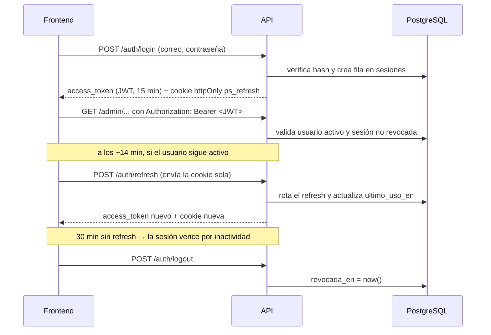
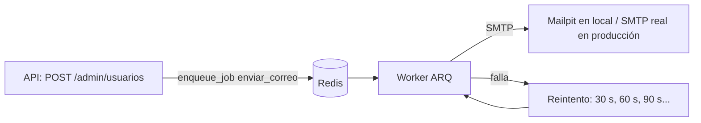

# PriceScope Backend — Guía v2: primeras funcionalidades

> **Punto de partida:** el proyecto tal como queda al terminar la guía v1 (API con `/health`, TimescaleDB y Redis en Docker, Alembic con la migración de TimescaleDB, Ruff y pytest en verde).
>
> **Objetivo:** implementar el backend de las épicas en curso: **E02 · Solicitar una demo**, **E03 · Ingresar a la plataforma** y **E11 · Panel de administración v1**. E01 (landing) no tiene backend.
>
> **Documento hermano:** `pricescope-db-tablas.md` describe cada tabla y columna. Esta guía dice dónde va cada tabla en el código y cómo se usa.

Convenciones (las mismas de la v1):

- Todos los comandos se ejecutan desde `backend/`.
- Los archivos se escriben *a mano* con el contenido exacto que aparece. Cuando un archivo de la v1 cambia, se muestra completo.
- Commits con la clave del ticket: `PSB2BA-502: endpoint POST de solicitudes`.

---

## Índice

1. [Decisiones técnicas tomadas](#1-decisiones-técnicas-tomadas)
2. [Tickets, endpoints y orden de trabajo](#2-tickets-endpoints-y-orden-de-trabajo)
3. [Dependencias nuevas y Mailpit](#3-dependencias-nuevas-y-mailpit)
4. [Variables de entorno y configuración](#4-variables-de-entorno-y-configuración)
5. [Estructura de carpetas](#5-estructura-de-carpetas)
6. [Modelos: dónde va cada tabla](#6-modelos-dónde-va-cada-tabla)
7. [Migración y datos iniciales](#7-migración-y-datos-iniciales)
8. [Seguridad: contraseñas, JWT y enlaces](#8-seguridad-contraseñas-jwt-y-enlaces)
9. [Errores y schemas](#9-errores-y-schemas)
10. [Servicios: la lógica de negocio](#10-servicios-la-lógica-de-negocio)
11. [Dependencias de FastAPI: usuario actual y admin](#11-dependencias-de-fastapi-usuario-actual-y-admin)
12. [Endpoints y `main.py`](#12-endpoints-y-mainpy)
13. [Worker de correos con ARQ](#13-worker-de-correos-con-arq)
14. [Probar todo a mano](#14-probar-todo-a-mano)
15. [Tests](#15-tests)
16. [Contrato para el frontend](#16-contrato-para-el-frontend)
17. [ADRs a registrar](#17-adrs-a-registrar)
18. [Errores comunes](#18-errores-comunes)

---

## 1. Decisiones técnicas tomadas

| Tema | Decisión | Motivo | En esta guía |
| --- | --- | --- | --- |
| Autenticación (spikes 285 y 286) | **JWT** de acceso corto (15 min) + **refresh token** opaco guardado en la base y enviado en cookie `httpOnly` | El JWT evita una consulta por request para validar la firma; el refresh en base permite cerrar sesión de verdad y expirar por inactividad | Sí |
| Librería de JWT | **PyJWT** | Simple y mantenida | Sí |
| Contraseñas | **pwdlib** con **argon2** | passlib está poco mantenido | Sí |
| Roles (spike 285) | Dos roles: `cliente` y `admin`, en `usuarios.rol`. El visitante no tiene cuenta | Es lo que pide el MVP; sin permisos más finos | Sí |
| Tareas en segundo plano | **ARQ** | Async nativo, más liviano; usa el Redis que ya tenemos | Sí (correos) |
| Correo | **aiosmtplib**; en local, **Mailpit** atrapa los correos | Async y sin dependencias extra; Mailpit evita mandar correos reales | Sí |
| Vinculación usuario ↔ tiendas (spike 521) | Muchos a muchos con `usuario_tienda`; tienda ↔ scraper 1 a 1 por `scraper_clave` | Una tienda se scrapea una vez y la ven todos sus clientes | Sí |
| Scraping | **Playwright** si la tienda renderiza con JavaScript; **Scrapy** si el HTML es estático | Se elige por tienda | No (épica de extracción) |

---

## 2. Tickets, endpoints y orden de trabajo

Todos los endpoints van bajo `/api/v1`.

| Ticket | Qué entrega | Endpoints | Responsable en Jira |
| --- | --- | --- | --- |
| PSB2BA-285 | Spike: modelo de roles → ADR | — | Angel |
| PSB2BA-286 | Spike: JWT o sesiones → ADR | — | Sin asignar |
| PSB2BA-521 | Spike: vinculación usuario–tiendas → ADR + esquema | — | Angel |
| PSB2BA-336 | Rutas protegidas por rol | Dependencias `UsuarioActual` y `AdminActual` | Angel |
| PSB2BA-502 | API de solicitudes de demo | `POST /demo/solicitudes` (público) · `GET /admin/solicitudes` | Luciano |
| PSB2BA-315 | Crear usuario (admin) | `POST /admin/usuarios` | Gabriel |
| PSB2BA-318 | Correo de acceso al crear el usuario | Tarea ARQ `enviar_correo` · `POST /admin/usuarios/{id}/reenviar-acceso` | Gabriel |
| PSB2BA-321 | Login con correo y contraseña | `POST /auth/login` · `GET /auth/yo` | Gabriel |
| PSB2BA-333 | Login de administrador | Mismo `POST /auth/login`; devuelve `rol` para redirigir. Admin inicial con `scripts/seed.py` | Angel |
| PSB2BA-325 | Cierre y expiración de sesión | `POST /auth/refresh` · `POST /auth/logout` | Gabriel |
| PSB2BA-329 | Recuperación de contraseña | `POST /auth/recuperar` · `POST /auth/token/verificar` · `POST /auth/password` | Gabriel |
| PSB2BA-437 | Listar y buscar usuarios | `GET /admin/usuarios` · `GET /admin/usuarios/{id}` | Angel |
| PSB2BA-522 | Vincular usuario con tiendas | `GET /admin/tiendas` · `GET`, `POST /admin/usuarios/{id}/tiendas` · `DELETE /admin/usuarios/{id}/tiendas/{tienda_id}` | Angel |

### Orden de trabajo

Para que tres personas no se pisen, la base compartida entra primero en un solo Pull Request:

1. **PR 0 · Base (secciones 3 a 11 de esta guía):** dependencias, configuración, modelos, migración, seguridad, errores, schemas y dependencias de auth. Cierra 285, 286, 521 (con sus ADRs) y 336. Lo hace una persona y el resto lo revisa.
2. **En paralelo, cuando PR 0 está en `main`:**
   - 502 · solicitudes de demo (independiente de todo lo demás).
   - 321 → 325 → 329 · login, sesión y recuperación.
   - 315 → 318 · alta de usuario y correo.
   - 437 y 522 · listado y tiendas (dependen de 315).
   - 333 · se valida con el admin del seed cuando 321 está hecho.

Cada PR suma sus tests (sección 15) y no toca archivos de otro ticket salvo `api/v1/router.py`.

---

## 3. Dependencias nuevas y Mailpit

### 3.1 Librerías

```bash
uv add pyjwt "pwdlib[argon2]" aiosmtplib arq "pydantic[email]" tzdata
```

| Librería | Para qué |
| --- | --- |
| `pyjwt` | Firmar y validar los tokens de acceso |
| `pwdlib[argon2]` | Hashear y verificar contraseñas con argon2 |
| `aiosmtplib` | Enviar correos por SMTP de forma asíncrona |
| `arq` | Cola de tareas sobre Redis (el worker que manda los correos) |
| `pydantic[email]` | Habilita `EmailStr` para validar correos |
| `tzdata` | Zonas horarias en Windows (validar el horario de la demo en hora de Argentina) |

### 3.2 Mailpit: correos de prueba en local

Mailpit es un servidor SMTP falso: atrapa todos los correos y los muestra en una página web. Así se prueban el correo de bienvenida y el de recuperación sin mandar nada real.

Agregá este servicio a `docker-compose.yml`, dentro de `services:` (debajo de `redis`):

```yaml
  mailpit:
    image: axllent/mailpit:v1.30
    ports:
      - "127.0.0.1:${SMTP_PORT:-1025}:1025"
      - "127.0.0.1:8025:8025"
```

Los puertos quedan atados a `127.0.0.1` a propósito: la interfaz de Mailpit no tiene contraseña y no debe quedar expuesta en la red.

```bash
docker compose up -d
```

Abrí `http://localhost:8025`: es la bandeja donde van a aparecer los correos.

---

## 4. Variables de entorno y configuración

### 4.1 `.env.example`

Agregá al final de `.env.example` (y copiá lo mismo a tu `.env`):

```bash
# --- Seguridad ---
JWT_SECRET=cambiar_por_un_valor_largo_y_aleatorio
ACCESS_TOKEN_MINUTOS=15
SESION_INACTIVIDAD_MINUTOS=30

# --- Frontend ---
FRONTEND_URL=http://localhost:5173
CORS_ORIGINS=["http://localhost:5173"]

# --- Correo (Mailpit en local) ---
SMTP_HOST=localhost
SMTP_PORT=1025
SMTP_TLS=false
CORREO_REMITENTE=PriceScope <no-responder@pricescope.local>
```

En tu `.env`, reemplazá `JWT_SECRET` por un valor aleatorio propio:

```bash
uv run python -c "import secrets; print(secrets.token_urlsafe(64))"
```

`CORS_ORIGINS` va en formato JSON (con corchetes y comillas dobles): pydantic-settings lo convierte en lista.

### 4.2 `app/core/config.py` (reemplaza el de la v1)

```python
from pathlib import Path

from pydantic_settings import BaseSettings, SettingsConfigDict
from sqlalchemy.engine import URL

BASE_DIR = Path(__file__).resolve().parents[2]


class Settings(BaseSettings):
    model_config = SettingsConfigDict(
        env_file=BASE_DIR / ".env",
        env_file_encoding="utf-8",
        extra="ignore",
    )

    app_name: str = "PriceScope API"
    environment: str = "local"  # local | test | staging | production

    # PostgreSQL / TimescaleDB
    postgres_user: str
    postgres_password: str
    postgres_db: str
    postgres_host: str = "localhost"
    postgres_port: int = 5432

    # Redis
    redis_host: str = "localhost"
    redis_port: int = 6379

    # Seguridad
    jwt_secret: str
    jwt_algoritmo: str = "HS256"
    access_token_minutos: int = 15
    sesion_inactividad_minutos: int = 30
    sesion_duracion_max_horas: int = 12
    token_definir_horas: int = 72
    token_restablecer_minutos: int = 60

    # Frontend
    frontend_url: str = "http://localhost:5173"
    cors_origins: list[str] = ["http://localhost:5173"]

    # Correo
    smtp_host: str = "localhost"
    smtp_port: int = 1025
    smtp_usuario: str | None = None
    smtp_password: str | None = None
    smtp_tls: bool = False
    correo_remitente: str = "PriceScope <no-responder@pricescope.local>"

    @property
    def database_url(self) -> URL:
        return URL.create(
            drivername="postgresql+asyncpg",
            username=self.postgres_user,
            password=self.postgres_password,
            host=self.postgres_host,
            port=self.postgres_port,
            database=self.postgres_db,
        )

    @property
    def redis_url(self) -> str:
        return f"redis://{self.redis_host}:{self.redis_port}/0"

    @property
    def cookies_seguras(self) -> bool:
        # En local y en tests la API corre por http, sin https.
        return self.environment not in ("local", "test")


settings = Settings()
```

### 4.3 `app/core/database.py` (reemplaza el de la v1)

Dos cambios: una **convención de nombres** para que Alembic genere restricciones con nombres estables, y un pool sin conexiones reutilizables en los tests (cada test usa su propio *event loop*).

```python
from collections.abc import AsyncIterator

from sqlalchemy import MetaData
from sqlalchemy.ext.asyncio import AsyncSession, async_sessionmaker, create_async_engine
from sqlalchemy.orm import DeclarativeBase
from sqlalchemy.pool import NullPool

from app.core.config import settings

CONVENCION_NOMBRES = {
    "ix": "ix_%(column_0_label)s",
    "uq": "uq_%(table_name)s_%(column_0_name)s",
    "ck": "ck_%(table_name)s_%(constraint_name)s",
    "fk": "fk_%(table_name)s_%(column_0_name)s_%(referred_table_name)s",
    "pk": "pk_%(table_name)s",
}

_opciones = {"poolclass": NullPool} if settings.environment == "test" else {"pool_pre_ping": True}
engine = create_async_engine(settings.database_url, **_opciones)
SessionLocal = async_sessionmaker(engine, expire_on_commit=False)


class Base(DeclarativeBase):
    metadata = MetaData(naming_convention=CONVENCION_NOMBRES)


async def get_session() -> AsyncIterator[AsyncSession]:
    async with SessionLocal() as session:
        yield session
```

> Si ya aplicaste la migración de TimescaleDB de la v1, no pasa nada: esa migración no crea tablas, así que la convención no afecta nada existente.

### 4.4 `app/core/cache.py` (reemplaza el de la v1)

```python
from arq.connections import RedisSettings
from redis.asyncio import Redis

from app.core.config import settings

redis_client = Redis.from_url(settings.redis_url, decode_responses=True)

# Conexión que usan la API (para encolar) y el worker (para ejecutar)
ajustes_arq = RedisSettings(host=settings.redis_host, port=settings.redis_port)
```

---

## 5. Estructura de carpetas

Lo nuevo respecto de la v1 está marcado con `+`.

```
backend/
├── app/
│   ├── main.py
│   ├── core/
│   │   ├── config.py
│   │   ├── database.py
│   │   ├── cache.py
│   │   └── seguridad.py          + hash de contraseñas, JWT y tokens de enlace
│   ├── models/                   + LAS TABLAS (una clase por tabla)
│   │   ├── __init__.py           + importa todos los modelos
│   │   ├── enums.py              + valores cerrados: rol, estado, tipo...
│   │   ├── mixins.py             + id y fechas comunes
│   │   ├── usuario.py            + tabla usuarios
│   │   ├── sesion.py             + tabla sesiones
│   │   ├── token_acceso.py       + tabla tokens_acceso
│   │   ├── solicitud_demo.py     + tabla solicitudes_demo
│   │   └── tienda.py             + tablas tiendas y usuario_tienda
│   ├── schemas/                  + forma del JSON que entra y sale
│   │   ├── __init__.py
│   │   ├── comunes.py
│   │   ├── auth.py
│   │   ├── demo.py
│   │   ├── usuarios.py
│   │   └── tiendas.py
│   ├── services/                 + lógica de negocio (sin HTTP)
│   │   ├── __init__.py
│   │   ├── errores.py
│   │   ├── autenticacion.py
│   │   ├── tokens.py
│   │   ├── correo.py
│   │   ├── solicitudes.py
│   │   ├── usuarios.py
│   │   └── tiendas.py
│   ├── api/                      + capa HTTP
│   │   ├── __init__.py
│   │   ├── deps.py               + usuario actual, admin, sesión de base, cola
│   │   └── v1/
│   │       ├── __init__.py
│   │       ├── router.py         + junta todos los routers bajo /api/v1
│   │       ├── auth.py
│   │       ├── demo.py
│   │       ├── admin_solicitudes.py
│   │       ├── admin_usuarios.py
│   │       └── admin_tiendas.py
│   └── workers/                  + tareas en segundo plano
│       ├── __init__.py
│       └── tareas.py
├── scripts/                      + scripts que se corren a mano
│   ├── __init__.py
│   └── seed.py
├── docs/adr/                     + decisiones de arquitectura
├── migrations/versions/          (la migración nueva se agrega acá)
└── tests/
    ├── __init__.py               + permite importar helpers con from tests.conftest import ...
    ├── conftest.py               +
    ├── test_app.py
    ├── test_demo.py              +
    ├── test_auth.py              +
    └── test_usuarios.py          +
```

La regla de cada capa:

| Capa | Hace | No hace |
| --- | --- | --- |
| `models/` | Describe las tablas | Lógica, validación de JSON |
| `schemas/` | Valida lo que entra y da forma a lo que sale | Consultas a la base |
| `services/` | Reglas de negocio y consultas | Saber de HTTP, status codes o cookies |
| `api/` | Recibe el request, llama al servicio, arma la respuesta | Reglas de negocio |

Crear carpetas y archivos vacíos (macOS / Linux):

```bash
mkdir -p app/models app/schemas app/services app/api/v1 app/workers scripts docs/adr
touch app/core/seguridad.py \
      app/models/{__init__,enums,mixins,usuario,sesion,token_acceso,solicitud_demo,tienda}.py \
      app/schemas/{__init__,comunes,auth,demo,usuarios,tiendas}.py \
      app/services/{__init__,errores,autenticacion,tokens,correo,solicitudes,usuarios,tiendas}.py \
      app/api/__init__.py app/api/deps.py \
      app/api/v1/{__init__,router,auth,demo,admin_solicitudes,admin_usuarios,admin_tiendas}.py \
      app/workers/{__init__,tareas}.py \
      scripts/{__init__,seed}.py \
      tests/{__init__,conftest,test_demo,test_auth,test_usuarios}.py
```

Windows (PowerShell):

```powershell
mkdir app/models, app/schemas, app/services, app/api/v1, app/workers, scripts, docs/adr -Force
$archivos = @(
  "app/core/seguridad.py",
  "app/models/__init__.py","app/models/enums.py","app/models/mixins.py","app/models/usuario.py","app/models/sesion.py","app/models/token_acceso.py","app/models/solicitud_demo.py","app/models/tienda.py",
  "app/schemas/__init__.py","app/schemas/comunes.py","app/schemas/auth.py","app/schemas/demo.py","app/schemas/usuarios.py","app/schemas/tiendas.py",
  "app/services/__init__.py","app/services/errores.py","app/services/autenticacion.py","app/services/tokens.py","app/services/correo.py","app/services/solicitudes.py","app/services/usuarios.py","app/services/tiendas.py",
  "app/api/__init__.py","app/api/deps.py",
  "app/api/v1/__init__.py","app/api/v1/router.py","app/api/v1/auth.py","app/api/v1/demo.py","app/api/v1/admin_solicitudes.py","app/api/v1/admin_usuarios.py","app/api/v1/admin_tiendas.py",
  "app/workers/__init__.py","app/workers/tareas.py",
  "scripts/__init__.py","scripts/seed.py",
  "tests/__init__.py","tests/conftest.py","tests/test_demo.py","tests/test_auth.py","tests/test_usuarios.py"
)
New-Item -ItemType File $archivos -Force
```

Los `__init__.py` quedan vacíos, salvo `app/models/__init__.py` (sección 6.8).

---

## 6. Modelos: dónde va cada tabla

Cada tabla de `pricescope-db-tablas.md` es una clase en `app/models/`. Alembic lee estas clases para generar la migración.

| Tabla | Archivo | Clase |
| --- | --- | --- |
| `usuarios` | `app/models/usuario.py` | `Usuario` |
| `sesiones` | `app/models/sesion.py` | `Sesion` |
| `tokens_acceso` | `app/models/token_acceso.py` | `TokenAcceso` |
| `solicitudes_demo` | `app/models/solicitud_demo.py` | `SolicitudDemo` |
| `tiendas` | `app/models/tienda.py` | `Tienda` |
| `usuario_tienda` | `app/models/tienda.py` | `UsuarioTienda` |

### 6.1 `app/models/enums.py`

Los valores cerrados se definen una sola vez y los usan modelos, schemas y servicios.

```python
from enum import StrEnum


class Rol(StrEnum):
    CLIENTE = "cliente"
    ADMIN = "admin"


class EstadoUsuario(StrEnum):
    PENDIENTE = "pendiente"
    ACTIVO = "activo"
    BLOQUEADO = "bloqueado"
    BAJA = "baja"


class TipoToken(StrEnum):
    DEFINIR = "definir"
    RESTABLECER = "restablecer"


class TipoOrganizacion(StrEnum):
    RETAIL = "retail"
    FONDO = "fondo"
    MEDIO = "medio"
    OTRO = "otro"


class Rubro(StrEnum):
    SUPERMERCADO = "supermercado"
    ELECTRO = "electro"
    MODA = "moda"
```

### 6.2 `app/models/mixins.py`

Columnas que se repiten en varias tablas.

```python
import enum
import uuid
from datetime import datetime

from sqlalchemy import DateTime, Enum, func
from sqlalchemy.orm import Mapped, mapped_column


class ConId:
    id: Mapped[uuid.UUID] = mapped_column(primary_key=True, default=uuid.uuid4)


class ConFechas:
    creado_en: Mapped[datetime] = mapped_column(DateTime(timezone=True), server_default=func.now())
    actualizado_en: Mapped[datetime] = mapped_column(
        DateTime(timezone=True), server_default=func.now(), onupdate=func.now()
    )


def columna_enum(tipo: type[enum.Enum], nombre: str) -> Enum:
    """VARCHAR + CHECK con los valores del enum (no un ENUM nativo de PostgreSQL)."""
    return Enum(
        tipo,
        name=nombre,
        native_enum=False,
        create_constraint=True,
        length=20,
        values_callable=lambda miembros: [m.value for m in miembros],
    )
```

`values_callable` hace que en la base se guarde `"cliente"` (el valor) y no `"CLIENTE"` (el nombre).

### 6.3 `app/models/usuario.py`

```python
from datetime import datetime

from sqlalchemy import DateTime, String
from sqlalchemy.orm import Mapped, mapped_column

from app.core.database import Base
from app.models.enums import EstadoUsuario, Rol
from app.models.mixins import ConFechas, ConId, columna_enum


class Usuario(ConId, ConFechas, Base):
    __tablename__ = "usuarios"

    nombre: Mapped[str] = mapped_column(String(120))
    empresa: Mapped[str] = mapped_column(String(160))
    correo: Mapped[str] = mapped_column(String(254), unique=True)
    password_hash: Mapped[str | None] = mapped_column(String(255))
    rol: Mapped[Rol] = mapped_column(
        columna_enum(Rol, "rol_usuario"),
        default=Rol.CLIENTE,
        server_default=Rol.CLIENTE.value,
        index=True,
    )
    estado: Mapped[EstadoUsuario] = mapped_column(
        columna_enum(EstadoUsuario, "estado_usuario"),
        default=EstadoUsuario.PENDIENTE,
        server_default=EstadoUsuario.PENDIENTE.value,
        index=True,
    )
    ultimo_acceso: Mapped[datetime | None] = mapped_column(DateTime(timezone=True))
```

`Mapped[str | None]` hace que la columna acepte `NULL`; `Mapped[str]`, que no.

### 6.4 `app/models/sesion.py`

```python
import uuid
from datetime import datetime

from sqlalchemy import DateTime, ForeignKey, String, func
from sqlalchemy.orm import Mapped, mapped_column

from app.core.database import Base
from app.models.mixins import ConId


class Sesion(ConId, Base):
    __tablename__ = "sesiones"

    usuario_id: Mapped[uuid.UUID] = mapped_column(
        ForeignKey("usuarios.id", ondelete="CASCADE"), index=True
    )
    refresh_hash: Mapped[str] = mapped_column(String(64), unique=True)
    creada_en: Mapped[datetime] = mapped_column(DateTime(timezone=True), server_default=func.now())
    ultimo_uso_en: Mapped[datetime] = mapped_column(DateTime(timezone=True))
    expira_en: Mapped[datetime] = mapped_column(DateTime(timezone=True))
    revocada_en: Mapped[datetime | None] = mapped_column(DateTime(timezone=True))
    user_agent: Mapped[str | None] = mapped_column(String(255))
```

### 6.5 `app/models/token_acceso.py`

```python
import uuid
from datetime import datetime

from sqlalchemy import DateTime, ForeignKey, Index, String, func
from sqlalchemy.orm import Mapped, mapped_column

from app.core.database import Base
from app.models.enums import TipoToken
from app.models.mixins import ConId, columna_enum


class TokenAcceso(ConId, Base):
    __tablename__ = "tokens_acceso"
    __table_args__ = (Index("ix_tokens_acceso_usuario_tipo", "usuario_id", "tipo"),)

    usuario_id: Mapped[uuid.UUID] = mapped_column(ForeignKey("usuarios.id", ondelete="CASCADE"))
    tipo: Mapped[TipoToken] = mapped_column(columna_enum(TipoToken, "tipo_token"))
    token_hash: Mapped[str] = mapped_column(String(64), unique=True)
    expira_en: Mapped[datetime] = mapped_column(DateTime(timezone=True))
    usado_en: Mapped[datetime | None] = mapped_column(DateTime(timezone=True))
    creado_en: Mapped[datetime] = mapped_column(DateTime(timezone=True), server_default=func.now())
```

### 6.6 `app/models/solicitud_demo.py`

```python
from datetime import datetime

from sqlalchemy import DateTime, String, Text, func
from sqlalchemy.orm import Mapped, mapped_column

from app.core.database import Base
from app.models.enums import TipoOrganizacion
from app.models.mixins import ConId, columna_enum


class SolicitudDemo(ConId, Base):
    __tablename__ = "solicitudes_demo"

    empresa: Mapped[str] = mapped_column(String(160))
    nombre: Mapped[str] = mapped_column(String(120))
    correo: Mapped[str] = mapped_column(String(254))
    tipo_organizacion: Mapped[TipoOrganizacion] = mapped_column(
        columna_enum(TipoOrganizacion, "tipo_organizacion")
    )
    comentario: Mapped[str | None] = mapped_column(Text)
    fecha_preferida: Mapped[datetime] = mapped_column(DateTime(timezone=True))
    creada_en: Mapped[datetime] = mapped_column(
        DateTime(timezone=True), server_default=func.now(), index=True
    )
```

### 6.7 `app/models/tienda.py`

```python
import uuid
from datetime import datetime

from sqlalchemy import DateTime, ForeignKey, String, func, true
from sqlalchemy.orm import Mapped, mapped_column

from app.core.database import Base
from app.models.enums import Rubro
from app.models.mixins import ConFechas, ConId, columna_enum


class Tienda(ConId, ConFechas, Base):
    __tablename__ = "tiendas"

    nombre: Mapped[str] = mapped_column(String(120))
    slug: Mapped[str] = mapped_column(String(60), unique=True)
    url_base: Mapped[str] = mapped_column(String(255))
    rubro: Mapped[Rubro] = mapped_column(columna_enum(Rubro, "rubro_tienda"))
    scraper_clave: Mapped[str] = mapped_column(String(60), unique=True)
    activa: Mapped[bool] = mapped_column(default=True, server_default=true())


class UsuarioTienda(Base):
    __tablename__ = "usuario_tienda"

    usuario_id: Mapped[uuid.UUID] = mapped_column(
        ForeignKey("usuarios.id", ondelete="CASCADE"), primary_key=True
    )
    tienda_id: Mapped[uuid.UUID] = mapped_column(
        ForeignKey("tiendas.id", ondelete="RESTRICT"), primary_key=True, index=True
    )
    asignada_en: Mapped[datetime] = mapped_column(
        DateTime(timezone=True), server_default=func.now()
    )
    asignada_por: Mapped[uuid.UUID | None] = mapped_column(
        ForeignKey("usuarios.id", ondelete="SET NULL")
    )
```

No definimos `relationship()` entre modelos: con SQLAlchemy async, cargar relaciones «sin querer» produce errores (`MissingGreenlet`). Las consultas que cruzan tablas se escriben explícitas en `services/`.

### 6.8 `app/models/__init__.py`

Este archivo **no** queda vacío: importa todos los modelos para que Alembic y la app los encuentren con un solo import.

```python
from app.models.enums import EstadoUsuario, Rol, Rubro, TipoOrganizacion, TipoToken
from app.models.sesion import Sesion
from app.models.solicitud_demo import SolicitudDemo
from app.models.tienda import Tienda, UsuarioTienda
from app.models.token_acceso import TokenAcceso
from app.models.usuario import Usuario

__all__ = [
    "EstadoUsuario",
    "Rol",
    "Rubro",
    "Sesion",
    "SolicitudDemo",
    "Tienda",
    "TipoOrganizacion",
    "TipoToken",
    "TokenAcceso",
    "Usuario",
    "UsuarioTienda",
]
```

**Regla:** cada modelo nuevo se agrega acá. Si no, Alembic no lo ve y la migración sale vacía.

---

## 7. Migración y datos iniciales

### 7.1 Que Alembic vea los modelos

En `migrations/env.py` (el de la v1), reemplazá el comentario:

```python
# v2: importar los modelos acá para que Alembic los detecte, por ejemplo:
# from app import models  # noqa: F401
```

por:

```python
import app.models  # noqa: F401  (registra todas las tablas en Base.metadata)
```

### 7.2 Generar y revisar la migración

```bash
uv run alembic revision --autogenerate -m "usuarios sesiones tokens demo tiendas"
```

Abrí el archivo nuevo en `migrations/versions/` y revisá, **antes de aplicarlo**, que tenga:

- `op.create_table` para las 6 tablas: `usuarios`, `sesiones`, `tokens_acceso`, `solicitudes_demo`, `tiendas` y `usuario_tienda`.
- Las restricciones `CHECK` de los enums (`ck_usuarios_rol_usuario`, etc.).
- Índices únicos en `usuarios.correo`, `sesiones.refresh_hash`, `tokens_acceso.token_hash`, `tiendas.slug` y `tiendas.scraper_clave`.
- Que `downgrade()` borre las tablas en orden inverso (primero las que tienen claves foráneas).
- **Nada** sobre la extensión `timescaledb` ni tablas que no reconozcas.

Aplicá y verificá:

```bash
uv run alembic upgrade head
docker compose exec timescaledb psql -U pricescope -d pricescope -c "\dt"
```

Tenés que ver las 6 tablas más `alembic_version`.

### 7.3 Datos iniciales: admin y tiendas (`scripts/seed.py`)

Nadie se registra solo, así que el **primer administrador** se crea con un script. El mismo script carga el catálogo de tiendas (las tiendas son código: cada una tiene su scraper).

```python
"""Crea el primer administrador y el catálogo de tiendas. Se puede correr varias veces."""

import asyncio
import getpass

from sqlalchemy import select

from app.core.database import SessionLocal, engine
from app.core.seguridad import hashear_password
from app.models import EstadoUsuario, Rol, Rubro, Tienda, Usuario
from app.schemas.comunes import validar_password

# Reemplazar por las tiendas reales cuando se definan los scrapers.
TIENDAS = [
    {
        "nombre": "Tienda A",
        "slug": "tienda-a",
        "url_base": "https://tienda-a.example.com",
        "rubro": Rubro.SUPERMERCADO,
        "scraper_clave": "tienda_a",
    },
    {
        "nombre": "Tienda B",
        "slug": "tienda-b",
        "url_base": "https://tienda-b.example.com",
        "rubro": Rubro.ELECTRO,
        "scraper_clave": "tienda_b",
    },
    {
        "nombre": "Tienda C",
        "slug": "tienda-c",
        "url_base": "https://tienda-c.example.com",
        "rubro": Rubro.MODA,
        "scraper_clave": "tienda_c",
    },
]


async def main() -> None:
    async with SessionLocal() as db:
        for datos in TIENDAS:
            existe = await db.scalar(select(Tienda.id).where(Tienda.slug == datos["slug"]))
            if not existe:
                db.add(Tienda(**datos))
                print(f"Tienda creada: {datos['nombre']}")

        correo = input("Correo del administrador: ").strip().lower()
        if await db.scalar(select(Usuario.id).where(Usuario.correo == correo)):
            print("Ese correo ya existe; no se crea el administrador.")
        else:
            nombre = input("Nombre y apellido: ").strip()
            password = getpass.getpass("Contraseña (8+ caracteres, una mayúscula y un número): ")
            validar_password(password)
            db.add(
                Usuario(
                    nombre=nombre,
                    empresa="PriceScope",
                    correo=correo,
                    password_hash=hashear_password(password),
                    rol=Rol.ADMIN,
                    estado=EstadoUsuario.ACTIVO,
                )
            )
            print(f"Administrador creado: {correo}")

        await db.commit()
    await engine.dispose()


if __name__ == "__main__":
    asyncio.run(main())
```

Se ejecuta como módulo, desde `backend/` (los archivos que importa se escriben en las secciones 8 y 9):

```bash
uv run python -m scripts.seed
```

Cada persona lo corre una vez en su base local, con su propio correo.

---

## 8. Seguridad: contraseñas, JWT y enlaces

### Cómo funciona la sesión



- El **access token** (JWT) viaja en el header `Authorization`. Dura 15 minutos y lleva `sub` (usuario), `rol` y `sid` (sesión).
- El **refresh token** es un valor aleatorio. El navegador lo guarda en una cookie `httpOnly` (JavaScript no la puede leer) y en la base solo queda su hash.
- **Cerrar sesión** revoca la fila de `sesiones`: el JWT deja de servir en el próximo request, aunque no haya vencido.
- **Inactividad:** si pasan 30 minutos sin renovar, la sesión se revoca. El frontend solo renueva si el usuario está activo.

### `app/core/seguridad.py`

```python
import hashlib
import secrets
import uuid
from datetime import UTC, datetime, timedelta
from typing import Any

import jwt
from pwdlib import PasswordHash

from app.core.config import settings

_hasher = PasswordHash.recommended()  # argon2

# Hash de una contraseña cualquiera: se verifica contra él cuando el correo no existe,
# para que el login tarde lo mismo exista o no la cuenta.
HASH_FALSO = _hasher.hash("contraseña-que-nunca-coincide")


def hashear_password(password: str) -> str:
    return _hasher.hash(password)


def verificar_password(password: str, password_hash: str) -> bool:
    return _hasher.verify(password, password_hash)


def hash_token(token: str) -> str:
    return hashlib.sha256(token.encode()).hexdigest()


def generar_token_opaco() -> tuple[str, str]:
    """Devuelve (token para el usuario, hash para la base)."""
    token = secrets.token_urlsafe(32)
    return token, hash_token(token)


def crear_access_token(usuario_id: uuid.UUID, rol: str, sesion_id: uuid.UUID) -> str:
    ahora = datetime.now(UTC)
    payload = {
        "sub": str(usuario_id),
        "rol": str(rol),
        "sid": str(sesion_id),
        "iat": ahora,
        "exp": ahora + timedelta(minutes=settings.access_token_minutos),
    }
    return jwt.encode(payload, settings.jwt_secret, algorithm=settings.jwt_algoritmo)


def decodificar_access_token(token: str) -> dict[str, Any]:
    """Lanza jwt.PyJWTError si la firma no es válida o el token venció."""
    return jwt.decode(token, settings.jwt_secret, algorithms=[settings.jwt_algoritmo])
```

---

## 9. Errores y schemas

### 9.1 `app/services/errores.py`

Los servicios no conocen HTTP: lanzan estas excepciones y `main.py` las convierte en respuestas con el status correcto.

```python
class ErrorNegocio(Exception):
    status_code = 400

    def __init__(self, detalle: str) -> None:
        super().__init__(detalle)
        self.detalle = detalle


class NoEncontrado(ErrorNegocio):
    status_code = 404


class Conflicto(ErrorNegocio):
    status_code = 409
```

Todas las respuestas de error tienen la misma forma que las de FastAPI: `{"detail": "mensaje"}`.

### 9.2 `app/schemas/comunes.py`

```python
from typing import Annotated

from pydantic import AfterValidator, BaseModel


class Pagina[T](BaseModel):
    items: list[T]
    total: int
    pagina: int
    tamano: int


class Mensaje(BaseModel):
    mensaje: str


def validar_password(valor: str) -> str:
    if len(valor) < 8 or not any(c.isupper() for c in valor) or not any(c.isdigit() for c in valor):
        raise ValueError(
            "La contraseña debe tener al menos 8 caracteres, una mayúscula y un número"
        )
    return valor


Password = Annotated[str, AfterValidator(validar_password)]
```

Las reglas de contraseña son las mismas que muestra el frontend en UX03.

### 9.3 `app/schemas/auth.py`

```python
import uuid
from typing import Literal

from pydantic import BaseModel, EmailStr, Field

from app.models import Rol, TipoToken
from app.schemas.comunes import Password


class LoginEntrada(BaseModel):
    correo: EmailStr
    password: str = Field(min_length=1, max_length=128)


class TokenSalida(BaseModel):
    access_token: str
    token_type: str = "bearer"
    expira_en: int  # segundos
    rol: Rol


class CorreoEntrada(BaseModel):
    correo: EmailStr


class TokenEntrada(BaseModel):
    token: str = Field(min_length=20, max_length=200)


class EstadoTokenSalida(BaseModel):
    estado: Literal["valido", "vencido", "invalido"]
    tipo: TipoToken | None = None


class DefinirPasswordEntrada(TokenEntrada):
    password: Password


class UsuarioActualSalida(BaseModel):
    id: uuid.UUID
    nombre: str
    empresa: str
    correo: str
    rol: Rol
    tienda_ids: list[uuid.UUID]
```

### 9.4 `app/schemas/demo.py`

```python
import uuid
from datetime import UTC, datetime
from zoneinfo import ZoneInfo

from pydantic import AwareDatetime, BaseModel, ConfigDict, EmailStr, Field, field_validator

from app.models import TipoOrganizacion

ZONA_AR = ZoneInfo("America/Argentina/Buenos_Aires")


class SolicitudDemoEntrada(BaseModel):
    model_config = ConfigDict(str_strip_whitespace=True)

    empresa: str = Field(min_length=2, max_length=160)
    nombre: str = Field(min_length=2, max_length=120)
    correo: EmailStr
    tipo_organizacion: TipoOrganizacion
    comentario: str | None = Field(default=None, max_length=1000)
    fecha_preferida: AwareDatetime

    @field_validator("fecha_preferida")
    @classmethod
    def horario_laboral(cls, valor: datetime) -> datetime:
        if valor <= datetime.now(UTC):
            raise ValueError("La fecha tiene que ser futura")
        local = valor.astimezone(ZONA_AR)
        if local.weekday() >= 5 or not 9 <= local.hour < 18:
            raise ValueError(
                "Elegí un horario de lunes a viernes, entre las 9 y las 18 (hora de Argentina)"
            )
        return valor


class SolicitudDemoSalida(BaseModel):
    model_config = ConfigDict(from_attributes=True)

    id: uuid.UUID
    empresa: str
    nombre: str
    correo: str
    tipo_organizacion: TipoOrganizacion
    comentario: str | None
    fecha_preferida: datetime
    creada_en: datetime
```

`AwareDatetime` obliga a mandar la zona horaria (`2026-11-03T10:00:00-03:00`). Así no hay dudas sobre qué hora eligió el visitante.

### 9.5 `app/schemas/usuarios.py`

```python
import uuid
from datetime import datetime

from pydantic import BaseModel, ConfigDict, EmailStr, Field

from app.models import EstadoUsuario, Rol


class UsuarioCrear(BaseModel):
    model_config = ConfigDict(str_strip_whitespace=True)

    nombre: str = Field(min_length=2, max_length=120)
    empresa: str = Field(min_length=2, max_length=160)
    correo: EmailStr
    rol: Rol = Rol.CLIENTE


class UsuarioSalida(BaseModel):
    model_config = ConfigDict(from_attributes=True)

    id: uuid.UUID
    nombre: str
    empresa: str
    correo: str
    rol: Rol
    estado: EstadoUsuario
    ultimo_acceso: datetime | None
    creado_en: datetime
    cantidad_tiendas: int = 0


class UsuarioCreadoSalida(BaseModel):
    usuario: UsuarioSalida
    correo_encolado: bool
```

`correo_encolado: false` le avisa al panel que el correo no salió y que ofrezca «Reenviar correo» (UX11).

### 9.6 `app/schemas/tiendas.py`

```python
import uuid

from pydantic import BaseModel, ConfigDict

from app.models import Rubro


class TiendaSalida(BaseModel):
    model_config = ConfigDict(from_attributes=True)

    id: uuid.UUID
    nombre: str
    slug: str
    url_base: str
    rubro: Rubro
    activa: bool


class AsignarTiendaEntrada(BaseModel):
    tienda_id: uuid.UUID
```

---

## 10. Servicios: la lógica de negocio

### 10.1 `app/services/correo.py`

Arma los correos y los encola. El envío real lo hace el worker (sección 13), así un SMTP caído no rompe el alta del usuario (criterio del ticket 318).

```python
import html
import logging
from email.message import EmailMessage
from typing import Protocol

import aiosmtplib

from app.core.config import settings
from app.models import Usuario

log = logging.getLogger(__name__)


class ColaDeTareas(Protocol):
    async def enqueue_job(self, function: str, *args: object, **kwargs: object) -> object: ...


def _armar(nombre: str, intro: str, enlace: str, boton: str) -> tuple[str, str]:
    texto = (
        f"Hola {nombre}:\n\n{intro}\n\n{enlace}\n\n"
        "Si no esperabas este correo, podés ignorarlo.\n\nEquipo de PriceScope"
    )
    cuerpo_html = (
        f"<p>Hola {html.escape(nombre)}:</p><p>{intro}</p>"
        f'<p><a href="{enlace}">{boton}</a></p>'
        "<p>Si no esperabas este correo, podés ignorarlo.</p><p>Equipo de PriceScope</p>"
    )
    return texto, cuerpo_html


async def _encolar(
    cola: ColaDeTareas, para: str, asunto: str, texto: str, cuerpo_html: str
) -> bool:
    try:
        await cola.enqueue_job("enviar_correo", para, asunto, texto, cuerpo_html)
        return True
    except Exception:
        log.exception("No se pudo encolar el correo para %s", para)
        return False


async def encolar_bienvenida(cola: ColaDeTareas, usuario: Usuario, token: str) -> bool:
    enlace = f"{settings.frontend_url}/definir-contrasena/{token}"
    intro = (
        "Creamos tu cuenta de PriceScope. Para ingresar, definí tu contraseña con este enlace "
        f"(vence en {settings.token_definir_horas} horas):"
    )
    texto, cuerpo = _armar(usuario.nombre, intro, enlace, "Definir mi contraseña")
    return await _encolar(cola, usuario.correo, "Tu cuenta de PriceScope está lista", texto, cuerpo)


async def encolar_recuperacion(cola: ColaDeTareas, usuario: Usuario, token: str) -> bool:
    enlace = f"{settings.frontend_url}/restablecer/{token}"
    intro = (
        "Recibimos un pedido para restablecer tu contraseña. Usá este enlace "
        f"(vence en {settings.token_restablecer_minutos} minutos):"
    )
    texto, cuerpo = _armar(usuario.nombre, intro, enlace, "Restablecer mi contraseña")
    return await _encolar(
        cola, usuario.correo, "Restablecé tu contraseña de PriceScope", texto, cuerpo
    )


async def enviar_smtp(para: str, asunto: str, texto: str, cuerpo_html: str) -> None:
    mensaje = EmailMessage()
    mensaje["From"] = settings.correo_remitente
    mensaje["To"] = para
    mensaje["Subject"] = asunto
    mensaje.set_content(texto)
    mensaje.add_alternative(cuerpo_html, subtype="html")
    await aiosmtplib.send(
        mensaje,
        hostname=settings.smtp_host,
        port=settings.smtp_port,
        username=settings.smtp_usuario,
        password=settings.smtp_password,
        start_tls=settings.smtp_tls,
    )
```

### 10.2 `app/services/tokens.py`

Enlaces de un solo uso. Lo usan el alta (315), el correo de bienvenida (318) y la recuperación (329).

```python
import asyncio
import uuid
from datetime import UTC, datetime, timedelta
from typing import Literal

from sqlalchemy import select, update
from sqlalchemy.ext.asyncio import AsyncSession

from app.core.config import settings
from app.core.seguridad import generar_token_opaco, hash_token, hashear_password
from app.models import EstadoUsuario, Sesion, TipoToken, TokenAcceso, Usuario
from app.services.errores import ErrorNegocio

DURACION = {
    TipoToken.DEFINIR: timedelta(hours=settings.token_definir_horas),
    TipoToken.RESTABLECER: timedelta(minutes=settings.token_restablecer_minutos),
}


async def emitir_token(db: AsyncSession, usuario_id: uuid.UUID, tipo: TipoToken) -> str:
    """Invalida los enlaces anteriores del mismo tipo y crea uno nuevo. No hace commit."""
    ahora = datetime.now(UTC)
    await db.execute(
        update(TokenAcceso)
        .where(
            TokenAcceso.usuario_id == usuario_id,
            TokenAcceso.tipo == tipo,
            TokenAcceso.usado_en.is_(None),
        )
        .values(usado_en=ahora)
    )
    token, token_hash = generar_token_opaco()
    db.add(
        TokenAcceso(
            usuario_id=usuario_id,
            tipo=tipo,
            token_hash=token_hash,
            expira_en=ahora + DURACION[tipo],
        )
    )
    return token


async def estado_token(
    db: AsyncSession, token: str
) -> tuple[Literal["valido", "vencido", "invalido"], TipoToken | None]:
    registro = await db.scalar(
        select(TokenAcceso).where(TokenAcceso.token_hash == hash_token(token))
    )
    if registro is None or registro.usado_en is not None:
        return "invalido", None
    if registro.expira_en <= datetime.now(UTC):
        return "vencido", registro.tipo
    return "valido", registro.tipo


async def consumir_token(db: AsyncSession, token: str, password: str) -> None:
    """Define o restablece la contraseña. Activa al usuario pendiente y cierra sus sesiones."""
    ahora = datetime.now(UTC)
    registro = await db.scalar(
        select(TokenAcceso).where(TokenAcceso.token_hash == hash_token(token)).with_for_update()
    )
    if registro is None or registro.usado_en is not None:
        raise ErrorNegocio("El enlace no es válido. Pedí uno nuevo al equipo de PriceScope.")
    if registro.expira_en <= ahora:
        raise ErrorNegocio("El enlace venció. Pedí uno nuevo.")

    usuario = await db.get(Usuario, registro.usuario_id)
    if usuario is None or usuario.estado in (EstadoUsuario.BLOQUEADO, EstadoUsuario.BAJA):
        raise ErrorNegocio("El enlace no es válido. Pedí uno nuevo al equipo de PriceScope.")

    usuario.password_hash = await asyncio.to_thread(hashear_password, password)
    if usuario.estado == EstadoUsuario.PENDIENTE:
        usuario.estado = EstadoUsuario.ACTIVO
    registro.usado_en = ahora
    await db.execute(
        update(Sesion)
        .where(Sesion.usuario_id == usuario.id, Sesion.revocada_en.is_(None))
        .values(revocada_en=ahora)
    )
    await db.commit()
```

`asyncio.to_thread` corre el hash de argon2 (que tarda unos 50 ms de CPU) fuera del *event loop*, para no frenar los demás requests.

### 10.3 `app/services/autenticacion.py`

```python
import asyncio
import uuid
from datetime import UTC, datetime, timedelta

from sqlalchemy import select, update
from sqlalchemy.ext.asyncio import AsyncSession

from app.core.config import settings
from app.core.seguridad import (
    HASH_FALSO,
    crear_access_token,
    generar_token_opaco,
    hash_token,
    verificar_password,
)
from app.models import EstadoUsuario, Sesion, Usuario


async def autenticar(db: AsyncSession, correo: str, password: str) -> Usuario | None:
    """Devuelve el usuario si puede ingresar. Mismo resultado (None) para todos los fallos."""
    usuario = await db.scalar(select(Usuario).where(Usuario.correo == correo.lower()))
    if usuario is None or usuario.password_hash is None:
        await asyncio.to_thread(verificar_password, password, HASH_FALSO)
        return None
    valida = await asyncio.to_thread(verificar_password, password, usuario.password_hash)
    if not valida or usuario.estado != EstadoUsuario.ACTIVO:
        return None
    return usuario


async def abrir_sesion(
    db: AsyncSession, usuario: Usuario, user_agent: str | None
) -> tuple[str, str]:
    """Devuelve (access_token, refresh_token)."""
    ahora = datetime.now(UTC)
    refresh, refresh_hash = generar_token_opaco()
    sesion = Sesion(
        id=uuid.uuid4(),
        usuario_id=usuario.id,
        refresh_hash=refresh_hash,
        ultimo_uso_en=ahora,
        expira_en=ahora + timedelta(hours=settings.sesion_duracion_max_horas),
        user_agent=(user_agent or "")[:255] or None,
    )
    db.add(sesion)
    usuario.ultimo_acceso = ahora
    await db.commit()
    return crear_access_token(usuario.id, usuario.rol, sesion.id), refresh


async def renovar_sesion(db: AsyncSession, refresh: str) -> tuple[Usuario, str, str] | None:
    """Rota el refresh token. Devuelve (usuario, access nuevo, refresh nuevo) o None si venció."""
    ahora = datetime.now(UTC)
    sesion = await db.scalar(
        select(Sesion).where(Sesion.refresh_hash == hash_token(refresh)).with_for_update()
    )
    if sesion is None or sesion.revocada_en is not None:
        return None

    usuario = await db.get(Usuario, sesion.usuario_id)
    inactiva = (
        sesion.ultimo_uso_en + timedelta(minutes=settings.sesion_inactividad_minutos) <= ahora
    )
    if (
        inactiva
        or sesion.expira_en <= ahora
        or usuario is None
        or usuario.estado != EstadoUsuario.ACTIVO
    ):
        sesion.revocada_en = ahora
        await db.commit()
        return None

    nuevo, nuevo_hash = generar_token_opaco()
    sesion.refresh_hash = nuevo_hash
    sesion.ultimo_uso_en = ahora
    await db.commit()
    return usuario, crear_access_token(usuario.id, usuario.rol, sesion.id), nuevo


async def cerrar_sesion(db: AsyncSession, sesion_id: uuid.UUID) -> None:
    await db.execute(
        update(Sesion)
        .where(Sesion.id == sesion_id, Sesion.revocada_en.is_(None))
        .values(revocada_en=datetime.now(UTC))
    )
    await db.commit()
```

El `id` de la sesión se genera antes de guardarla porque va dentro del JWT.

### 10.4 `app/services/solicitudes.py`

```python
from sqlalchemy import func, select
from sqlalchemy.ext.asyncio import AsyncSession

from app.models import SolicitudDemo
from app.schemas.demo import SolicitudDemoEntrada


async def crear_solicitud(db: AsyncSession, datos: SolicitudDemoEntrada) -> SolicitudDemo:
    solicitud = SolicitudDemo(**datos.model_dump())
    solicitud.correo = solicitud.correo.lower()
    db.add(solicitud)
    await db.commit()
    await db.refresh(solicitud)
    return solicitud


async def listar_solicitudes(
    db: AsyncSession, pagina: int, tamano: int
) -> tuple[list[SolicitudDemo], int]:
    total = await db.scalar(select(func.count()).select_from(SolicitudDemo)) or 0
    filas = await db.scalars(
        select(SolicitudDemo)
        .order_by(SolicitudDemo.creada_en.desc())
        .offset((pagina - 1) * tamano)
        .limit(tamano)
    )
    return list(filas), total
```

### 10.5 `app/services/usuarios.py`

```python
import uuid

from sqlalchemy import func, or_, select
from sqlalchemy.exc import IntegrityError
from sqlalchemy.ext.asyncio import AsyncSession

from app.models import EstadoUsuario, Rol, TipoToken, Usuario, UsuarioTienda
from app.schemas.usuarios import UsuarioCrear
from app.services import correo, tokens
from app.services.correo import ColaDeTareas
from app.services.errores import Conflicto, ErrorNegocio, NoEncontrado


async def obtener_usuario(db: AsyncSession, usuario_id: uuid.UUID) -> Usuario:
    usuario = await db.get(Usuario, usuario_id)
    if usuario is None:
        raise NoEncontrado("El usuario no existe")
    return usuario


async def contar_tiendas(db: AsyncSession, usuario_id: uuid.UUID) -> int:
    return await db.scalar(select(func.count()).where(UsuarioTienda.usuario_id == usuario_id)) or 0


async def crear_usuario(
    db: AsyncSession, cola: ColaDeTareas, datos: UsuarioCrear
) -> tuple[Usuario, bool]:
    """Crea el usuario en estado pendiente y encola el correo de bienvenida."""
    correo_normalizado = datos.correo.lower()
    if await db.scalar(select(Usuario.id).where(Usuario.correo == correo_normalizado)):
        raise Conflicto("Ya existe un usuario con ese correo")

    usuario = Usuario(
        nombre=datos.nombre, empresa=datos.empresa, correo=correo_normalizado, rol=datos.rol
    )
    db.add(usuario)
    try:
        await db.flush()
    except IntegrityError:
        await db.rollback()
        raise Conflicto("Ya existe un usuario con ese correo") from None

    token = await tokens.emitir_token(db, usuario.id, TipoToken.DEFINIR)
    await db.commit()
    await db.refresh(usuario)
    encolado = await correo.encolar_bienvenida(cola, usuario, token)
    return usuario, encolado


async def reenviar_acceso(db: AsyncSession, cola: ColaDeTareas, usuario_id: uuid.UUID) -> bool:
    usuario = await obtener_usuario(db, usuario_id)
    if usuario.estado != EstadoUsuario.PENDIENTE:
        raise ErrorNegocio("El usuario ya definió su contraseña")
    token = await tokens.emitir_token(db, usuario.id, TipoToken.DEFINIR)
    await db.commit()
    return await correo.encolar_bienvenida(cola, usuario, token)


async def solicitar_recuperacion(
    db: AsyncSession, cola: ColaDeTareas, correo_ingresado: str
) -> None:
    """Solo actúa si la cuenta existe y está activa. La respuesta HTTP es siempre la misma."""
    usuario = await db.scalar(select(Usuario).where(Usuario.correo == correo_ingresado.lower()))
    if usuario is None or usuario.estado != EstadoUsuario.ACTIVO:
        return
    token = await tokens.emitir_token(db, usuario.id, TipoToken.RESTABLECER)
    await db.commit()
    await correo.encolar_recuperacion(cola, usuario, token)


async def listar_usuarios(
    db: AsyncSession,
    *,
    q: str | None,
    rol: Rol | None,
    estado: EstadoUsuario | None,
    pagina: int,
    tamano: int,
) -> tuple[list[tuple[Usuario, int]], int]:
    filtros = []
    if q:
        patron = f"%{q.strip()}%"
        filtros.append(or_(Usuario.nombre.ilike(patron), Usuario.correo.ilike(patron)))
    if rol:
        filtros.append(Usuario.rol == rol)
    if estado:
        filtros.append(Usuario.estado == estado)

    total = await db.scalar(select(func.count()).select_from(Usuario).where(*filtros)) or 0

    cantidad = (
        select(func.count(UsuarioTienda.tienda_id))
        .where(UsuarioTienda.usuario_id == Usuario.id)
        .correlate(Usuario)
        .scalar_subquery()
    )
    filas = await db.execute(
        select(Usuario, cantidad.label("cantidad_tiendas"))
        .where(*filtros)
        .order_by(Usuario.creado_en.desc())
        .offset((pagina - 1) * tamano)
        .limit(tamano)
    )
    return [(usuario, cant) for usuario, cant in filas.all()], total
```

### 10.6 `app/services/tiendas.py`

```python
import uuid

from sqlalchemy import delete, select
from sqlalchemy.ext.asyncio import AsyncSession

from app.models import Rol, Tienda, Usuario, UsuarioTienda
from app.services.errores import Conflicto, ErrorNegocio, NoEncontrado
from app.services.usuarios import obtener_usuario


async def listar_catalogo(db: AsyncSession) -> list[Tienda]:
    filas = await db.scalars(select(Tienda).where(Tienda.activa.is_(True)).order_by(Tienda.nombre))
    return list(filas)


async def tiendas_de_usuario(db: AsyncSession, usuario_id: uuid.UUID) -> list[Tienda]:
    filas = await db.scalars(
        select(Tienda)
        .join(UsuarioTienda, UsuarioTienda.tienda_id == Tienda.id)
        .where(UsuarioTienda.usuario_id == usuario_id)
        .order_by(Tienda.nombre)
    )
    return list(filas)


async def ids_tiendas_visibles(db: AsyncSession, usuario: Usuario) -> list[uuid.UUID]:
    """Tiendas cuyos datos puede ver el usuario. Lo van a usar dashboard, matriz y alertas."""
    if usuario.rol == Rol.ADMIN:
        return list(await db.scalars(select(Tienda.id)))
    return list(
        await db.scalars(
            select(UsuarioTienda.tienda_id).where(UsuarioTienda.usuario_id == usuario.id)
        )
    )


async def asignar_tienda(
    db: AsyncSession, usuario_id: uuid.UUID, tienda_id: uuid.UUID, admin_id: uuid.UUID
) -> None:
    usuario = await obtener_usuario(db, usuario_id)
    if usuario.rol == Rol.ADMIN:
        raise ErrorNegocio("Las tiendas solo se asignan a clientes")
    tienda = await db.get(Tienda, tienda_id)
    if tienda is None or not tienda.activa:
        raise NoEncontrado("La tienda no existe")
    if await db.get(UsuarioTienda, (usuario_id, tienda_id)):
        raise Conflicto("La tienda ya está asignada a este usuario")
    db.add(UsuarioTienda(usuario_id=usuario_id, tienda_id=tienda_id, asignada_por=admin_id))
    await db.commit()


async def quitar_tienda(db: AsyncSession, usuario_id: uuid.UUID, tienda_id: uuid.UUID) -> None:
    resultado = await db.execute(
        delete(UsuarioTienda).where(
            UsuarioTienda.usuario_id == usuario_id, UsuarioTienda.tienda_id == tienda_id
        )
    )
    if resultado.rowcount == 0:
        raise NoEncontrado("La tienda no estaba asignada a este usuario")
    await db.commit()
```

---

## 11. Dependencias de FastAPI: usuario actual y admin

`app/api/deps.py` resuelve el ticket **336**: cualquier endpoint que reciba `UsuarioActual` exige sesión; uno que reciba `AdminActual` exige además rol admin.

```python
import uuid
from typing import Annotated

import jwt
from fastapi import Depends, HTTPException, Request, status
from fastapi.security import HTTPAuthorizationCredentials, HTTPBearer
from sqlalchemy import select
from sqlalchemy.ext.asyncio import AsyncSession

from app.core.database import get_session
from app.core.seguridad import decodificar_access_token
from app.models import EstadoUsuario, Rol, Sesion, Usuario
from app.services.correo import ColaDeTareas

SesionDB = Annotated[AsyncSession, Depends(get_session)]

_bearer = HTTPBearer(auto_error=False)


def get_cola(request: Request) -> ColaDeTareas:
    return request.app.state.arq


Cola = Annotated[ColaDeTareas, Depends(get_cola)]


async def get_usuario_actual(
    request: Request,
    db: SesionDB,
    credenciales: Annotated[HTTPAuthorizationCredentials | None, Depends(_bearer)],
) -> Usuario:
    no_autenticado = HTTPException(
        status.HTTP_401_UNAUTHORIZED, "No autenticado", headers={"WWW-Authenticate": "Bearer"}
    )
    if credenciales is None:
        raise no_autenticado
    try:
        payload = decodificar_access_token(credenciales.credentials)
        usuario_id = uuid.UUID(payload["sub"])
        sesion_id = uuid.UUID(payload["sid"])
    except (jwt.PyJWTError, KeyError, ValueError):
        raise no_autenticado from None

    usuario = await db.scalar(
        select(Usuario)
        .join(Sesion, Sesion.usuario_id == Usuario.id)
        .where(Usuario.id == usuario_id, Sesion.id == sesion_id, Sesion.revocada_en.is_(None))
    )
    if usuario is None or usuario.estado != EstadoUsuario.ACTIVO:
        raise no_autenticado

    request.state.sesion_id = sesion_id  # lo usa /auth/logout
    return usuario


UsuarioActual = Annotated[Usuario, Depends(get_usuario_actual)]


async def requiere_admin(usuario: UsuarioActual) -> Usuario:
    if usuario.rol != Rol.ADMIN:
        raise HTTPException(status.HTTP_403_FORBIDDEN, "No tenés permisos para esta acción")
    return usuario


AdminActual = Annotated[Usuario, Depends(requiere_admin)]
```

| Situación | Respuesta |
| --- | --- |
| Sin token, token vencido o sesión cerrada | `401 No autenticado` → el frontend lleva a `/ingresar` |
| Cliente en una ruta de admin | `403 No tenés permisos` → el frontend muestra la página 403 |
| Usuario bloqueado o dado de baja | `401` en el próximo request, aunque su token no haya vencido |

`Annotated[..., Depends(...)]` es la forma recomendada en FastAPI: el tipo queda claro y Ruff no marca el `Depends()` como valor por defecto.

---

## 12. Endpoints y `main.py`

### 12.1 `app/api/v1/demo.py` (502, público)

```python
from fastapi import APIRouter, status

from app.api.deps import SesionDB
from app.schemas.demo import SolicitudDemoEntrada, SolicitudDemoSalida
from app.services import solicitudes

router = APIRouter(prefix="/demo", tags=["demo"])


@router.post(
    "/solicitudes", response_model=SolicitudDemoSalida, status_code=status.HTTP_201_CREATED
)
async def crear_solicitud(datos: SolicitudDemoEntrada, db: SesionDB) -> SolicitudDemoSalida:
    solicitud = await solicitudes.crear_solicitud(db, datos)
    return SolicitudDemoSalida.model_validate(solicitud)
```

### 12.2 `app/api/v1/admin_solicitudes.py` (502, admin)

Cuando todo el router es de admin, la protección se pone una sola vez en `dependencies`.

```python
from typing import Annotated

from fastapi import APIRouter, Depends, Query

from app.api.deps import SesionDB, requiere_admin
from app.schemas.comunes import Pagina
from app.schemas.demo import SolicitudDemoSalida
from app.services import solicitudes

router = APIRouter(
    prefix="/admin/solicitudes",
    tags=["admin · solicitudes"],
    dependencies=[Depends(requiere_admin)],
)


@router.get("", response_model=Pagina[SolicitudDemoSalida])
async def listar_solicitudes(
    db: SesionDB,
    pagina: Annotated[int, Query(ge=1)] = 1,
    tamano: Annotated[int, Query(ge=1, le=100)] = 20,
) -> Pagina[SolicitudDemoSalida]:
    items, total = await solicitudes.listar_solicitudes(db, pagina, tamano)
    return Pagina[SolicitudDemoSalida](
        items=[SolicitudDemoSalida.model_validate(s) for s in items],
        total=total,
        pagina=pagina,
        tamano=tamano,
    )
```

### 12.3 `app/api/v1/auth.py` (321, 325, 329, 333)

```python
from fastapi import APIRouter, HTTPException, Request, Response, status

from app.api.deps import Cola, SesionDB, UsuarioActual
from app.core.config import settings
from app.schemas.auth import (
    CorreoEntrada,
    DefinirPasswordEntrada,
    EstadoTokenSalida,
    LoginEntrada,
    TokenEntrada,
    TokenSalida,
    UsuarioActualSalida,
)
from app.schemas.comunes import Mensaje
from app.services import autenticacion, tiendas, tokens, usuarios

router = APIRouter(prefix="/auth", tags=["auth"])

COOKIE_REFRESH = "ps_refresh"
RUTA_COOKIE = "/api/v1/auth"


def _guardar_refresh(response: Response, refresh: str) -> None:
    response.set_cookie(
        COOKIE_REFRESH,
        refresh,
        httponly=True,
        secure=settings.cookies_seguras,
        samesite="lax",
        max_age=settings.sesion_duracion_max_horas * 3600,
        path=RUTA_COOKIE,
    )


def _token_salida(access: str, rol: str) -> TokenSalida:
    return TokenSalida(access_token=access, expira_en=settings.access_token_minutos * 60, rol=rol)


@router.post("/login", response_model=TokenSalida)
async def login(
    datos: LoginEntrada, request: Request, response: Response, db: SesionDB
) -> TokenSalida:
    usuario = await autenticacion.autenticar(db, datos.correo, datos.password)
    if usuario is None:
        raise HTTPException(status.HTTP_401_UNAUTHORIZED, "Correo o contraseña incorrectos")
    access, refresh = await autenticacion.abrir_sesion(
        db, usuario, request.headers.get("user-agent")
    )
    _guardar_refresh(response, refresh)
    return _token_salida(access, usuario.rol)


@router.post("/refresh", response_model=TokenSalida)
async def refresh(request: Request, response: Response, db: SesionDB) -> TokenSalida:
    token = request.cookies.get(COOKIE_REFRESH)
    resultado = await autenticacion.renovar_sesion(db, token) if token else None
    if resultado is None:
        raise HTTPException(status.HTTP_401_UNAUTHORIZED, "Tu sesión venció. Ingresá de nuevo.")
    usuario, access, nuevo_refresh = resultado
    _guardar_refresh(response, nuevo_refresh)
    return _token_salida(access, usuario.rol)


@router.post("/logout", status_code=status.HTTP_204_NO_CONTENT)
async def logout(
    request: Request, response: Response, usuario: UsuarioActual, db: SesionDB
) -> None:
    await autenticacion.cerrar_sesion(db, request.state.sesion_id)
    response.delete_cookie(COOKIE_REFRESH, path=RUTA_COOKIE)


@router.get("/yo", response_model=UsuarioActualSalida)
async def yo(usuario: UsuarioActual, db: SesionDB) -> UsuarioActualSalida:
    ids = [t.id for t in await tiendas.tiendas_de_usuario(db, usuario.id)]
    return UsuarioActualSalida(
        id=usuario.id,
        nombre=usuario.nombre,
        empresa=usuario.empresa,
        correo=usuario.correo,
        rol=usuario.rol,
        tienda_ids=ids,
    )


@router.post("/token/verificar", response_model=EstadoTokenSalida)
async def verificar_token(datos: TokenEntrada, db: SesionDB) -> EstadoTokenSalida:
    estado, tipo = await tokens.estado_token(db, datos.token)
    return EstadoTokenSalida(estado=estado, tipo=tipo)


@router.post("/password", response_model=Mensaje)
async def definir_password(datos: DefinirPasswordEntrada, db: SesionDB) -> Mensaje:
    await tokens.consumir_token(db, datos.token, datos.password)
    return Mensaje(mensaje="Tu contraseña quedó guardada. Ya podés ingresar.")


@router.post("/recuperar", response_model=Mensaje, status_code=status.HTTP_202_ACCEPTED)
async def recuperar(datos: CorreoEntrada, db: SesionDB, cola: Cola) -> Mensaje:
    await usuarios.solicitar_recuperacion(db, cola, datos.correo)
    return Mensaje(
        mensaje="Si el correo corresponde a una cuenta, te enviamos un enlace para restablecer la contraseña."
    )
```

Detalles que piden los tickets y UX03:

- **Errores genéricos:** contraseña incorrecta, correo inexistente, usuario pendiente, bloqueado o dado de baja reciben el mismo `401 Correo o contraseña incorrectos`.
- **Recuperar** responde siempre `202` con el mismo mensaje, exista o no la cuenta.
- **Login de administrador (333):** es el mismo endpoint. El `rol` de la respuesta le dice al frontend si va a `/dashboard` o a `/admin`.
- `/auth/password` sirve para **definir** (bienvenida) y para **restablecer** (recuperación): el tipo lo sabe el token.

### 12.4 `app/api/v1/admin_usuarios.py` (315, 318, 437, 522)

```python
import uuid
from typing import Annotated

from fastapi import APIRouter, Query, status

from app.api.deps import AdminActual, Cola, SesionDB
from app.models import EstadoUsuario, Rol, Usuario
from app.schemas.comunes import Mensaje, Pagina
from app.schemas.tiendas import AsignarTiendaEntrada, TiendaSalida
from app.schemas.usuarios import UsuarioCreadoSalida, UsuarioCrear, UsuarioSalida
from app.services import tiendas, usuarios

router = APIRouter(prefix="/admin/usuarios", tags=["admin · usuarios"])


def _salida(usuario: Usuario, cantidad_tiendas: int) -> UsuarioSalida:
    return UsuarioSalida.model_validate(usuario).model_copy(
        update={"cantidad_tiendas": cantidad_tiendas}
    )


@router.get("", response_model=Pagina[UsuarioSalida])
async def listar_usuarios(
    db: SesionDB,
    _admin: AdminActual,
    q: Annotated[str | None, Query(max_length=100, description="Busca en nombre y correo")] = None,
    rol: Rol | None = None,
    estado: EstadoUsuario | None = None,
    pagina: Annotated[int, Query(ge=1)] = 1,
    tamano: Annotated[int, Query(ge=1, le=100)] = 20,
) -> Pagina[UsuarioSalida]:
    filas, total = await usuarios.listar_usuarios(
        db, q=q, rol=rol, estado=estado, pagina=pagina, tamano=tamano
    )
    return Pagina[UsuarioSalida](
        items=[_salida(u, c) for u, c in filas], total=total, pagina=pagina, tamano=tamano
    )


@router.post("", response_model=UsuarioCreadoSalida, status_code=status.HTTP_201_CREATED)
async def crear_usuario(
    datos: UsuarioCrear, db: SesionDB, cola: Cola, _admin: AdminActual
) -> UsuarioCreadoSalida:
    usuario, encolado = await usuarios.crear_usuario(db, cola, datos)
    return UsuarioCreadoSalida(usuario=_salida(usuario, 0), correo_encolado=encolado)


@router.get("/{usuario_id}", response_model=UsuarioSalida)
async def obtener_usuario(
    usuario_id: uuid.UUID, db: SesionDB, _admin: AdminActual
) -> UsuarioSalida:
    usuario = await usuarios.obtener_usuario(db, usuario_id)
    return _salida(usuario, await usuarios.contar_tiendas(db, usuario_id))


@router.post(
    "/{usuario_id}/reenviar-acceso", response_model=Mensaje, status_code=status.HTTP_202_ACCEPTED
)
async def reenviar_acceso(
    usuario_id: uuid.UUID, db: SesionDB, cola: Cola, _admin: AdminActual
) -> Mensaje:
    encolado = await usuarios.reenviar_acceso(db, cola, usuario_id)
    if not encolado:
        return Mensaje(mensaje="No pudimos enviar el correo. Probá de nuevo en unos minutos.")
    return Mensaje(mensaje="Enviamos un nuevo correo de acceso.")


@router.get("/{usuario_id}/tiendas", response_model=list[TiendaSalida])
async def tiendas_del_usuario(
    usuario_id: uuid.UUID, db: SesionDB, _admin: AdminActual
) -> list[TiendaSalida]:
    await usuarios.obtener_usuario(db, usuario_id)  # 404 si no existe
    return [
        TiendaSalida.model_validate(t) for t in await tiendas.tiendas_de_usuario(db, usuario_id)
    ]


@router.post(
    "/{usuario_id}/tiendas", response_model=list[TiendaSalida], status_code=status.HTTP_201_CREATED
)
async def asignar_tienda(
    usuario_id: uuid.UUID, datos: AsignarTiendaEntrada, db: SesionDB, admin: AdminActual
) -> list[TiendaSalida]:
    await tiendas.asignar_tienda(db, usuario_id, datos.tienda_id, admin.id)
    return [
        TiendaSalida.model_validate(t) for t in await tiendas.tiendas_de_usuario(db, usuario_id)
    ]


@router.delete("/{usuario_id}/tiendas/{tienda_id}", status_code=status.HTTP_204_NO_CONTENT)
async def quitar_tienda(
    usuario_id: uuid.UUID, tienda_id: uuid.UUID, db: SesionDB, _admin: AdminActual
) -> None:
    await tiendas.quitar_tienda(db, usuario_id, tienda_id)
```

Asignar devuelve la lista actualizada de tiendas del usuario, así el panel no necesita otra llamada.

### 12.5 `app/api/v1/admin_tiendas.py` (522)

```python
from fastapi import APIRouter, Depends

from app.api.deps import SesionDB, requiere_admin
from app.schemas.tiendas import TiendaSalida
from app.services import tiendas

router = APIRouter(
    prefix="/admin/tiendas", tags=["admin · tiendas"], dependencies=[Depends(requiere_admin)]
)


@router.get("", response_model=list[TiendaSalida])
async def listar_catalogo(db: SesionDB) -> list[TiendaSalida]:
    return [TiendaSalida.model_validate(t) for t in await tiendas.listar_catalogo(db)]
```

### 12.6 `app/api/v1/router.py`

```python
from fastapi import APIRouter

from app.api.v1 import admin_solicitudes, admin_tiendas, admin_usuarios, auth, demo

api_router = APIRouter(prefix="/api/v1")

api_router.include_router(auth.router)
api_router.include_router(demo.router)
api_router.include_router(admin_solicitudes.router)
api_router.include_router(admin_usuarios.router)
api_router.include_router(admin_tiendas.router)
```

### 12.7 `app/main.py` (reemplaza el de la v1)

```python
from collections.abc import AsyncIterator
from contextlib import asynccontextmanager

from arq import create_pool
from fastapi import FastAPI, Request, status
from fastapi.middleware.cors import CORSMiddleware
from fastapi.responses import JSONResponse
from sqlalchemy import text

from app.api.v1.router import api_router
from app.core.cache import ajustes_arq, redis_client
from app.core.config import settings
from app.core.database import engine
from app.services.errores import ErrorNegocio


@asynccontextmanager
async def lifespan(app: FastAPI) -> AsyncIterator[None]:
    app.state.arq = await create_pool(ajustes_arq)  # cola para encolar correos
    yield
    await app.state.arq.aclose()
    await redis_client.aclose()
    await engine.dispose()


app = FastAPI(title=settings.app_name, version="0.2.0", lifespan=lifespan)

app.add_middleware(
    CORSMiddleware,
    allow_origins=settings.cors_origins,
    allow_credentials=True,  # necesario para la cookie del refresh token
    allow_methods=["*"],
    allow_headers=["*"],
)


@app.exception_handler(ErrorNegocio)
async def manejar_error_negocio(request: Request, exc: ErrorNegocio) -> JSONResponse:
    return JSONResponse(status_code=exc.status_code, content={"detail": exc.detalle})


app.include_router(api_router)


@app.get("/health", tags=["sistema"])
async def health() -> JSONResponse:
    checks: dict[str, str] = {}

    try:
        async with engine.connect() as conn:
            version = await conn.scalar(
                text("SELECT extversion FROM pg_extension WHERE extname = 'timescaledb'")
            )
        checks["database"] = "ok"
        checks["timescaledb"] = version or "no instalada"
    except Exception as exc:
        checks["database"] = f"error: {exc.__class__.__name__}"

    try:
        await redis_client.ping()
        checks["redis"] = "ok"
    except Exception as exc:
        checks["redis"] = f"error: {exc.__class__.__name__}"

    healthy = checks.get("database") == "ok" and checks.get("redis") == "ok"
    return JSONResponse(
        status_code=status.HTTP_200_OK if healthy else status.HTTP_503_SERVICE_UNAVAILABLE,
        content={
            "status": "ok" if healthy else "degraded",
            "environment": settings.environment,
            **checks,
        },
    )
```

---

## 13. Worker de correos con ARQ

La API **encola** el correo en Redis y responde enseguida. Un proceso aparte, el **worker**, lo toma y lo envía; si el SMTP falla, reintenta.



### `app/workers/tareas.py`

```python
import aiosmtplib
from arq import Retry

from app.core.cache import ajustes_arq
from app.services.correo import enviar_smtp

MAX_INTENTOS = 5


async def enviar_correo(ctx: dict, para: str, asunto: str, texto: str, cuerpo_html: str) -> None:
    try:
        await enviar_smtp(para, asunto, texto, cuerpo_html)
    except (aiosmtplib.SMTPException, OSError) as exc:
        if ctx["job_try"] >= MAX_INTENTOS:
            raise
        raise Retry(defer=ctx["job_try"] * 30) from exc


class WorkerSettings:
    functions = [enviar_correo]
    redis_settings = ajustes_arq
    max_tries = MAX_INTENTOS
```

### Levantarlo

El worker corre en **otra terminal**, al mismo tiempo que la API:

```bash
uv run arq app.workers.tareas.WorkerSettings
```

Para desarrollo con recarga automática al guardar:

```bash
uv run arq app.workers.tareas.WorkerSettings --watch app
```

Si el worker no está corriendo, los correos quedan esperando en Redis y salen apenas se levanta.

---

## 14. Probar todo a mano

Necesitás tres terminales en `backend/`:

| Terminal | Comando |
| --- | --- |
| 1 | `docker compose up -d` (y dejarla libre) |
| 2 | `uv run uvicorn app.main:app --reload --port 8000` |
| 3 | `uv run arq app.workers.tareas.WorkerSettings --watch app` |

La forma más cómoda es Swagger en `http://localhost:8000/docs`: el botón **Authorize** guarda el token para todas las llamadas. El recorrido completo:

1. **Admin:** `uv run python -m scripts.seed` (si no lo corriste en la sección 7.3).
2. **Login admin:** `POST /api/v1/auth/login` con tu correo y contraseña → copiá `access_token` → **Authorize**.
3. **Solicitud de demo (público):** `POST /api/v1/demo/solicitudes`:

    ```json
    {
      "empresa": "Supermercados del Sur",
      "nombre": "Ana Pérez",
      "correo": "ana@example.com",
      "tipo_organizacion": "retail",
      "comentario": "Queremos monitorear 3 cadenas",
      "fecha_preferida": "2026-11-03T10:00:00-03:00"
    }
    ```

4. **Ver solicitudes:** `GET /api/v1/admin/solicitudes`.
5. **Crear el cliente:** `POST /api/v1/admin/usuarios` con nombre, empresa y correo de la solicitud → queda `pendiente`.
6. **Correo:** abrí `http://localhost:8025` → correo «Tu cuenta de PriceScope está lista» → copiá el token del enlace (lo que sigue a `/definir-contrasena/`).
7. **Definir contraseña:** `POST /api/v1/auth/password` con `{"token": "...", "password": "Cliente123"}` → el usuario pasa a `activo`.
8. **Tiendas:** `GET /api/v1/admin/tiendas` → copiá un `id` → `POST /api/v1/admin/usuarios/{id}/tiendas` con `{"tienda_id": "..."}`.
9. **Login cliente:** `POST /api/v1/auth/login` con el cliente → `GET /api/v1/auth/yo` muestra sus `tienda_ids`.
10. **Protección:** con el token del cliente, `GET /api/v1/admin/usuarios` → `403`.
11. **Recuperación:** `POST /api/v1/auth/recuperar` con el correo del cliente → nuevo correo en Mailpit.

---

## 15. Tests

### 15.1 Base de datos de tests

Los tests usan una base aparte, `pricescope_test`, que se borra y se recrea en cada test. Tu base de desarrollo no se toca. Se crea una sola vez:

```bash
docker compose exec timescaledb createdb -U pricescope pricescope_test
```

### 15.2 `tests/conftest.py`

```python
import os

# Antes de importar la app: base de tests y entorno de tests.
os.environ["ENVIRONMENT"] = "test"
os.environ["POSTGRES_DB"] = os.environ.get("POSTGRES_DB_TEST", "pricescope_test")

from collections.abc import AsyncIterator, Iterator  # noqa: E402

import pytest  # noqa: E402
from httpx import ASGITransport, AsyncClient  # noqa: E402

import app.models  # noqa: E402, F401
from app.api.deps import get_cola  # noqa: E402
from app.core.database import Base, SessionLocal, engine  # noqa: E402
from app.core.seguridad import hashear_password  # noqa: E402
from app.main import app as aplicacion  # noqa: E402
from app.models import EstadoUsuario, Rol, Usuario  # noqa: E402

PASSWORD = "Prueba123"


class ColaFalsa:
    """Reemplaza a Redis/ARQ: guarda los trabajos en una lista para poder revisarlos."""

    def __init__(self) -> None:
        self.trabajos: list[tuple[str, tuple]] = []

    async def enqueue_job(self, function: str, *args: object, **kwargs: object) -> None:
        self.trabajos.append((function, args))


@pytest.fixture(autouse=True)
async def base_limpia() -> AsyncIterator[None]:
    async with engine.begin() as conn:
        await conn.run_sync(Base.metadata.drop_all)
        await conn.run_sync(Base.metadata.create_all)
    yield


@pytest.fixture
def cola() -> Iterator[ColaFalsa]:
    falsa = ColaFalsa()
    aplicacion.dependency_overrides[get_cola] = lambda: falsa
    yield falsa
    aplicacion.dependency_overrides.clear()


@pytest.fixture
async def client(cola: ColaFalsa) -> AsyncIterator[AsyncClient]:
    async with AsyncClient(transport=ASGITransport(app=aplicacion), base_url="http://test") as c:
        yield c


async def crear_usuario_activo(correo: str, rol: Rol = Rol.CLIENTE) -> Usuario:
    async with SessionLocal() as db:
        usuario = Usuario(
            nombre="Usuario de prueba",
            empresa="Empresa de prueba",
            correo=correo,
            password_hash=hashear_password(PASSWORD),
            rol=rol,
            estado=EstadoUsuario.ACTIVO,
        )
        db.add(usuario)
        await db.commit()
        return usuario


async def login(client: AsyncClient, correo: str, password: str = PASSWORD) -> str:
    respuesta = await client.post(
        "/api/v1/auth/login", json={"correo": correo, "password": password}
    )
    assert respuesta.status_code == 200, respuesta.text
    return respuesta.json()["access_token"]


def bearer(token: str) -> dict[str, str]:
    return {"Authorization": f"Bearer {token}"}


@pytest.fixture
async def token_admin(client: AsyncClient) -> str:
    await crear_usuario_activo("admin@example.com", Rol.ADMIN)
    return await login(client, "admin@example.com")


@pytest.fixture
async def token_cliente(client: AsyncClient) -> str:
    await crear_usuario_activo("cliente@example.com")
    return await login(client, "cliente@example.com")
```

> Usá correos `@example.com` en los tests: el validador de correos rechaza dominios reservados como `.test` o `.local`.

Los tests no levantan Uvicorn ni el lifespan: `ASGITransport` llama a la app directo y `ColaFalsa` reemplaza a Redis. Por eso el worker no hace falta para correrlos.

### 15.3 `tests/test_demo.py`

```python
from datetime import datetime, timedelta
from zoneinfo import ZoneInfo

from httpx import AsyncClient

from tests.conftest import bearer

AR = ZoneInfo("America/Argentina/Buenos_Aires")
URL_PUBLICA = "/api/v1/demo/solicitudes"
URL_ADMIN = "/api/v1/admin/solicitudes"


def proximo_dia(habil: bool) -> str:
    dia = datetime.now(AR) + timedelta(days=1)
    while (dia.weekday() < 5) != habil:
        dia += timedelta(days=1)
    return dia.replace(hour=10, minute=0, second=0, microsecond=0).isoformat()


def datos(**cambios: object) -> dict:
    base = {
        "empresa": "Supermercados del Sur",
        "nombre": "Ana Pérez",
        "correo": "Ana@Example.com",
        "tipo_organizacion": "retail",
        "fecha_preferida": proximo_dia(habil=True),
    }
    return base | cambios


async def test_visitante_crea_solicitud(client: AsyncClient) -> None:
    respuesta = await client.post(URL_PUBLICA, json=datos())
    assert respuesta.status_code == 201
    assert respuesta.json()["correo"] == "ana@example.com"


async def test_rechaza_fin_de_semana(client: AsyncClient) -> None:
    respuesta = await client.post(URL_PUBLICA, json=datos(fecha_preferida=proximo_dia(habil=False)))
    assert respuesta.status_code == 422


async def test_listado_solo_para_admin(
    client: AsyncClient, token_cliente: str, token_admin: str
) -> None:
    await client.post(URL_PUBLICA, json=datos())

    assert (await client.get(URL_ADMIN)).status_code == 401
    assert (await client.get(URL_ADMIN, headers=bearer(token_cliente))).status_code == 403

    respuesta = await client.get(URL_ADMIN, headers=bearer(token_admin))
    assert respuesta.status_code == 200
    assert respuesta.json()["total"] == 1
```

### 15.4 `tests/test_usuarios.py`

```python
import re

from httpx import AsyncClient

from tests.conftest import ColaFalsa, bearer, login

URL = "/api/v1/admin/usuarios"
NUEVO = {"nombre": "Carla Gómez", "empresa": "Fondo Austral", "correo": "carla@example.com"}


def token_del_correo(cola: ColaFalsa) -> str:
    funcion, args = cola.trabajos[-1]
    assert funcion == "enviar_correo"
    texto = args[2]
    return re.search(r"/definir-contrasena/(\S+)", texto).group(1)


async def test_alta_queda_pendiente_y_encola_correo(
    client: AsyncClient, token_admin: str, cola: ColaFalsa
) -> None:
    respuesta = await client.post(URL, json=NUEVO, headers=bearer(token_admin))
    assert respuesta.status_code == 201
    cuerpo = respuesta.json()
    assert cuerpo["usuario"]["estado"] == "pendiente"
    assert cuerpo["correo_encolado"] is True
    assert len(cola.trabajos) == 1


async def test_correo_duplicado(client: AsyncClient, token_admin: str) -> None:
    await client.post(URL, json=NUEVO, headers=bearer(token_admin))
    respuesta = await client.post(
        URL, json=NUEVO | {"correo": "CARLA@example.com"}, headers=bearer(token_admin)
    )
    assert respuesta.status_code == 409


async def test_flujo_completo_alta_password_login(
    client: AsyncClient, token_admin: str, cola: ColaFalsa
) -> None:
    await client.post(URL, json=NUEVO, headers=bearer(token_admin))
    token = token_del_correo(cola)

    verificado = await client.post("/api/v1/auth/token/verificar", json={"token": token})
    assert verificado.json()["estado"] == "valido"

    definido = await client.post(
        "/api/v1/auth/password", json={"token": token, "password": "Carla2026"}
    )
    assert definido.status_code == 200

    acceso = await login(client, "carla@example.com", "Carla2026")
    yo = await client.get("/api/v1/auth/yo", headers=bearer(acceso))
    assert yo.json()["tienda_ids"] == []

    reusado = await client.post(
        "/api/v1/auth/password", json={"token": token, "password": "Otra2026x"}
    )
    assert reusado.status_code == 400


async def test_cliente_no_puede_crear_usuarios(client: AsyncClient, token_cliente: str) -> None:
    respuesta = await client.post(URL, json=NUEVO, headers=bearer(token_cliente))
    assert respuesta.status_code == 403
```

### 15.5 `tests/test_auth.py`

```python
from httpx import AsyncClient

from tests.conftest import bearer, crear_usuario_activo, login


async def test_login_incorrecto_es_generico(client: AsyncClient) -> None:
    await crear_usuario_activo("ana@example.com")
    mala_password = await client.post(
        "/api/v1/auth/login", json={"correo": "ana@example.com", "password": "Incorrecta1"}
    )
    no_existe = await client.post(
        "/api/v1/auth/login", json={"correo": "nadie@example.com", "password": "Incorrecta1"}
    )
    assert mala_password.status_code == no_existe.status_code == 401
    assert mala_password.json() == no_existe.json()


async def test_logout_invalida_el_token(client: AsyncClient) -> None:
    await crear_usuario_activo("ana@example.com")
    token = await login(client, "ana@example.com")

    assert (await client.post("/api/v1/auth/logout", headers=bearer(token))).status_code == 204
    assert (await client.get("/api/v1/auth/yo", headers=bearer(token))).status_code == 401


async def test_refresh_rota_la_sesion(client: AsyncClient) -> None:
    await crear_usuario_activo("ana@example.com")
    await login(client, "ana@example.com")  # deja la cookie ps_refresh en el cliente

    respuesta = await client.post("/api/v1/auth/refresh")
    assert respuesta.status_code == 200
    assert "access_token" in respuesta.json()


async def test_recuperar_responde_igual_exista_o_no(client: AsyncClient) -> None:
    await crear_usuario_activo("ana@example.com")
    existe = await client.post("/api/v1/auth/recuperar", json={"correo": "ana@example.com"})
    no_existe = await client.post("/api/v1/auth/recuperar", json={"correo": "nadie@example.com"})
    assert existe.status_code == no_existe.status_code == 202
    assert existe.json() == no_existe.json()
```

> `test_refresh_rota_la_sesion` funciona porque la cookie se guarda con `path=/api/v1/auth` y el cliente de httpx la reenvía sola, igual que un navegador.

### 15.6 Ejecutar

```bash
uv run ruff format .
uv run ruff check . --fix
uv run pytest
```

Para el ticket que estás haciendo, corré solo su archivo: `uv run pytest tests/test_demo.py -v`.

---

## 16. Contrato para el frontend

Resumen para Erika y para los tickets [FRONT]. La documentación completa, con botón para probar cada endpoint, está en `http://localhost:8000/docs`.

| Método | Ruta | Auth | Cuerpo | Respuesta |
| --- | --- | --- | --- | --- |
| `POST` | `/api/v1/demo/solicitudes` | Pública | `SolicitudDemoEntrada` | `201` solicitud creada |
| `POST` | `/api/v1/auth/login` | Pública | `{correo, password}` | `200 {access_token, expira_en, rol}` + cookie |
| `POST` | `/api/v1/auth/refresh` | Cookie | — | `200` igual que login · `401` si venció |
| `POST` | `/api/v1/auth/logout` | Bearer | — | `204` |
| `GET` | `/api/v1/auth/yo` | Bearer | — | `200 {id, nombre, empresa, correo, rol, tienda_ids}` |
| `POST` | `/api/v1/auth/token/verificar` | Pública | `{token}` | `200 {estado: valido \| vencido \| invalido, tipo}` |
| `POST` | `/api/v1/auth/password` | Pública | `{token, password}` | `200` · `400` enlace inválido o vencido |
| `POST` | `/api/v1/auth/recuperar` | Pública | `{correo}` | `202` siempre |
| `GET` | `/api/v1/admin/solicitudes` | Admin | `?pagina=&tamano=` | `200 Pagina` |
| `GET` | `/api/v1/admin/usuarios` | Admin | `?q=&rol=&estado=&pagina=&tamano=` | `200 Pagina` |
| `POST` | `/api/v1/admin/usuarios` | Admin | `{nombre, empresa, correo, rol}` | `201 {usuario, correo_encolado}` · `409` correo existente |
| `GET` | `/api/v1/admin/usuarios/{id}` | Admin | — | `200` usuario |
| `POST` | `/api/v1/admin/usuarios/{id}/reenviar-acceso` | Admin | — | `202` |
| `GET` | `/api/v1/admin/tiendas` | Admin | — | `200` catálogo |
| `GET` | `/api/v1/admin/usuarios/{id}/tiendas` | Admin | — | `200` tiendas asignadas |
| `POST` | `/api/v1/admin/usuarios/{id}/tiendas` | Admin | `{tienda_id}` | `201` lista actualizada · `409` ya asignada |
| `DELETE` | `/api/v1/admin/usuarios/{id}/tiendas/{tienda_id}` | Admin | — | `204` |

Notas para el frontend:

- **Cookies:** en `login`, `refresh` y `logout`, el `fetch` lleva `credentials: "include"`; si no, el navegador no guarda ni envía la cookie del refresh token.
- **Renovar la sesión:** pedir `/auth/refresh` un minuto antes de que venza el access token (`expira_en`), **solo si hubo actividad** del usuario. Si responde `401`, ir a `/ingresar` con el aviso de sesión vencida.
- **Rutas de los enlaces del correo:** `/definir-contrasena/:token` (sin ñ, para evitar problemas de codificación en la URL) y `/restablecer/:token`. Al abrir la pantalla, llamar a `/auth/token/verificar` para mostrar el estado válido, vencido o inválido.
- **Fechas:** se envían con zona horaria (`2026-11-03T10:00:00-03:00`) y llegan en UTC (`...Z`).
- **Errores:** siempre `{"detail": "..."}`. En los `422` de validación, `detail` es una lista con el campo que falló (`loc`) y el mensaje (`msg`).
- **Paginación:** `{items, total, pagina, tamano}`.

---

## 17. ADRs a registrar

Los spikes se cierran con un ADR en `docs/adr/`. Plantilla corta:

```markdown
# ADR-000N: <título>

- Estado: Aceptado
- Fecha: 2026-10-22
- Ticket: PSB2BA-XXX

## Contexto
Qué problema había y qué restricciones.

## Opciones evaluadas
1. Opción A: pros y contras.
2. Opción B: pros y contras.

## Decisión
Qué elegimos.

## Consecuencias
Qué gana el proyecto, qué riesgos asumimos y qué hay que revisar más adelante.
```

| Archivo | Ticket | Decisión a registrar |
| --- | --- | --- |
| `0001-autenticacion-jwt-y-refresh.md` | 286 | JWT de 15 min + refresh opaco en base y cookie `httpOnly`; PyJWT; pwdlib con argon2 |
| `0002-modelo-de-roles.md` | 285 | Roles `cliente` y `admin` en `usuarios.rol`; estados del usuario; sin permisos más finos |
| `0003-vinculacion-usuario-tiendas.md` | 521 | `usuario_tienda` muchos a muchos; tienda ↔ scraper 1 a 1; esquema de `pricescope-db-tablas.md` |
| `0004-cola-de-tareas-arq.md` | — | ARQ sobre Redis; reintentos de correo |
| `0005-scraping.md` | — | Playwright o Scrapy según cómo renderice cada tienda |

---

## 18. Errores comunes

| Síntoma | Causa | Solución |
| --- | --- | --- |
| La migración autogenerada sale vacía | Alembic no ve los modelos | Revisá el `import app.models` en `migrations/env.py` y que el modelo esté en `app/models/__init__.py` |
| `ValidationError ... jwt_secret Field required` | Falta `JWT_SECRET` en el `.env` | Agregá las variables de la sección 4.1 |
| `ImportError: email-validator is not installed` | Falta el extra de Pydantic | `uv add "pydantic[email]"` |
| `ZoneInfoNotFoundError` (Windows) | Falta la base de zonas horarias | `uv add tzdata` |
| `ConnectionError` al crear un usuario o al arrancar la API | Redis apagado (la API crea la cola al iniciar) | `docker compose up -d` |
| El correo no aparece en Mailpit | El worker no está corriendo | `uv run arq app.workers.tareas.WorkerSettings` en otra terminal |
| El login funciona pero `/auth/refresh` da `401` desde el navegador | El `fetch` no envía la cookie | `credentials: "include"` y origen del frontend en `CORS_ORIGINS` |
| Error de CORS en el navegador | Falta el origen del frontend | Agregalo a `CORS_ORIGINS` en el `.env` y reiniciá la API |
| `MissingGreenlet` | Se accedió a un atributo no cargado fuera de un `await` | Cargá los datos con una consulta explícita en el servicio (no usamos `relationship`) |
| `database "pricescope_test" does not exist` | Falta la base de tests | `docker compose exec timescaledb createdb -U pricescope pricescope_test` |
| `value is not a valid email address` en tests | Dominio reservado (`.test`, `.local`) | Usá `@example.com` |
| `Multiple head revisions are present` | Dos migraciones en paralelo | `uv run alembic merge heads -m "merge"` |

---

## Qué queda para la próxima guía

- Baja y bloqueo de cuentas (E12, tickets 440-443): las columnas y estados ya existen; faltan los endpoints.
- Límite de pedidos por IP en los endpoints públicos (`/demo/solicitudes`, `/auth/login`, `/auth/recuperar`).
- Modelos de productos, precios y cotizaciones (hypertables), ingesta de DolarAPI y Bluelytics, y el primer scraper.
- Dockerizar la API y el worker, y correr los tests en GitHub Actions.
