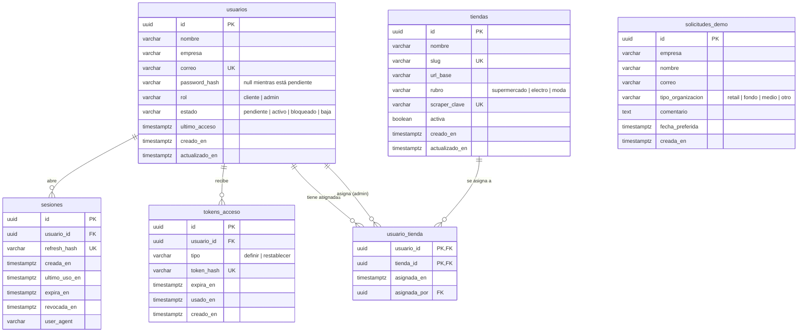

# PriceScope · Tablas de la base de datos (v2)

> Esquema de PostgreSQL + TimescaleDB para las épicas en curso: **E02 · Solicitar una demo**, **E03 · Ingresar a la plataforma** y **E11 · Panel de administración v1**. E01 (landing) no tiene backend.
>
> Este documento es también el **esquema propuesto del spike PSB2BA-521** (vinculación usuario ↔ tiendas ↔ scrapers). Dónde va cada tabla en el código y cómo se migra está en `pricescope-backend-guia-v2.md`.
>
> **Nota (29/10/2026):** la migración `a3f1c9e27b40` renombró tablas, columnas y valores de enum al inglés. Las secciones de abajo siguen con los nombres originales. Equivalencias de tablas: `usuarios`→`users`, `sesiones`→`sessions`, `tokens_acceso`→`access_tokens`, `solicitudes_demo`→`demo_requests`, `tiendas`→`stores`, `usuario_tienda`→`user_store`, `cambios_correo`→`email_changes`, `cotizaciones`→`exchange_rates`, `publicaciones`→`listings`, `precios`→`prices`.

---

## 1. Convenciones

| Tema | Regla |
| --- | --- |
| Idioma | Tablas y columnas en español, `snake_case`, igual que los tipos del frontend (`tienda_ids`, `ultimo_acceso`). Tablas en plural (`usuarios`); la tabla de vínculo, en singular (`usuario_tienda`). |
| Clave primaria | `id UUID`, generado en Python (`uuid.uuid4`). No es adivinable y el id existe antes de insertar. |
| Fechas | Siempre `TIMESTAMPTZ` (con zona horaria), guardadas en UTC. La API las devuelve en ISO 8601. |
| Auditoría | `creado_en` y `actualizado_en` en las tablas que se editan. |
| Valores cerrados (rol, estado, tipo) | `VARCHAR` + `CHECK` (`Enum(..., native_enum=False)` en SQLAlchemy). No usamos `ENUM` nativo de PostgreSQL porque agregar un valor después obliga a migraciones manuales. |
| Correos | Se guardan en minúsculas y son únicos en `usuarios`. |
| Secretos | Nunca se guarda una contraseña ni un token en texto plano: contraseñas con **argon2** (pwdlib) y tokens con **SHA-256**. |
| Borrado | En el MVP no se borran usuarios: se cambia su `estado`. Los vínculos `usuario_tienda` sí se borran. |

---

## 2. Diagrama

`solicitudes_demo` no tiene relaciones a propósito: una solicitud no se convierte en usuario. El administrador crea el usuario a mano con los datos precargados.

---

## 3. Tablas de las épicas en curso

### 3.1 `usuarios`

Clientes y administradores. Nadie se registra solo: el administrador crea la fila (PSB2BA-315) y el usuario define su contraseña desde el correo de bienvenida (PSB2BA-318).

| Columna | Tipo | Nulo | Default | Descripción |
| --- | --- | --- | --- | --- |
| `id` | `UUID` | No | `uuid4()` | Clave primaria |
| `nombre` | `VARCHAR(120)` | No | — | Nombre y apellido |
| `empresa` | `VARCHAR(160)` | No | — | Empresa del cliente |
| `correo` | `VARCHAR(254)` | No | — | Único, en minúsculas. Es el usuario de login |
| `password_hash` | `VARCHAR(255)` | **Sí** | `NULL` | Hash argon2. `NULL` mientras el usuario está `pendiente` |
| `rol` | `VARCHAR(20)` | No | `'cliente'` | `cliente` o `admin` |
| `estado` | `VARCHAR(20)` | No | `'pendiente'` | `pendiente`, `activo`, `bloqueado`, `baja` |
| `ultimo_acceso` | `TIMESTAMPTZ` | Sí | `NULL` | Se actualiza en cada login |
| `creado_en` | `TIMESTAMPTZ` | No | `now()` | — |
| `actualizado_en` | `TIMESTAMPTZ` | No | `now()` | Se actualiza en cada cambio |

Índices y restricciones:

- `UNIQUE (correo)`
- `INDEX (estado)` y `INDEX (rol)`: filtros del listado (PSB2BA-437)
- `CHECK` de `rol` y `estado` con los valores permitidos

Estados y transiciones:

| Desde | Hacia | Quién lo provoca | Ticket |
| --- | --- | --- | --- |
| *(nuevo)* | `pendiente` | El admin crea el usuario | 315 |
| `pendiente` | `activo` | El usuario define su contraseña con el enlace | 315 / 318 |
| `activo` | `bloqueado` / `baja` | El admin | v2 de E12 (440-443) |
| `bloqueado` | `activo` | El admin | v2 de E12 |

Solo un usuario `activo` puede iniciar sesión. `bloqueado` y `baja` reciben el mismo error genérico que una contraseña incorrecta.

### 3.2 `sesiones`

Una fila por sesión abierta. Guarda el **refresh token** (en hash) y permite cerrar sesión de verdad y expirar por inactividad (PSB2BA-325).

| Columna | Tipo | Nulo | Default | Descripción |
| --- | --- | --- | --- | --- |
| `id` | `UUID` | No | `uuid4()` | Va dentro del JWT como `sid` |
| `usuario_id` | `UUID` | No | — | FK → `usuarios.id`, `ON DELETE CASCADE` |
| `refresh_hash` | `VARCHAR(64)` | No | — | SHA-256 del refresh token. Cambia en cada renovación |
| `creada_en` | `TIMESTAMPTZ` | No | `now()` | Momento del login |
| `ultimo_uso_en` | `TIMESTAMPTZ` | No | `now()` | Última renovación. Mide la inactividad |
| `expira_en` | `TIMESTAMPTZ` | No | — | Vencimiento absoluto (por defecto, 12 horas después del login) |
| `revocada_en` | `TIMESTAMPTZ` | Sí | `NULL` | Se completa al cerrar sesión o al vencer |
| `user_agent` | `VARCHAR(255)` | Sí | `NULL` | Navegador, para auditoría |

Índices: `UNIQUE (refresh_hash)`, `INDEX (usuario_id)`.

Una sesión es válida solo si: `revocada_en IS NULL`, `expira_en > now()` y `ultimo_uso_en + 30 min > now()`.

### 3.3 `tokens_acceso`

Enlaces de un solo uso para **definir** la contraseña (correo de bienvenida) y para **restablecerla** (recuperación, PSB2BA-329). Los dos flujos comparten tabla y lógica.

| Columna | Tipo | Nulo | Default | Descripción |
| --- | --- | --- | --- | --- |
| `id` | `UUID` | No | `uuid4()` | — |
| `usuario_id` | `UUID` | No | — | FK → `usuarios.id`, `ON DELETE CASCADE` |
| `tipo` | `VARCHAR(20)` | No | — | `definir` o `restablecer` |
| `token_hash` | `VARCHAR(64)` | No | — | SHA-256 del token que viaja en el enlace |
| `expira_en` | `TIMESTAMPTZ` | No | — | `definir`: 72 horas. `restablecer`: 60 minutos |
| `usado_en` | `TIMESTAMPTZ` | Sí | `NULL` | Se completa al usarlo o al emitir uno nuevo del mismo tipo |
| `creado_en` | `TIMESTAMPTZ` | No | `now()` | — |

Índices: `UNIQUE (token_hash)`, `INDEX (usuario_id, tipo)`.

Reglas:

- Al emitir un token nuevo, los anteriores del mismo usuario y tipo se marcan como usados. Solo el último enlace funciona.
- Estados que ve el frontend (UX03): **válido** (existe, sin usar, no vencido), **vencido** (existe, sin usar, `expira_en` pasado) e **inválido** (no existe o ya se usó).

### 3.4 `solicitudes_demo`

Pedidos de demo del formulario público (PSB2BA-502). Sin estado ni correo de confirmación en el MVP.

| Columna | Tipo | Nulo | Default | Descripción |
| --- | --- | --- | --- | --- |
| `id` | `UUID` | No | `uuid4()` | — |
| `empresa` | `VARCHAR(160)` | No | — | — |
| `nombre` | `VARCHAR(120)` | No | — | — |
| `correo` | `VARCHAR(254)` | No | — | Correo laboral. **No** es único: la misma persona puede pedir dos demos |
| `tipo_organizacion` | `VARCHAR(20)` | No | — | `retail`, `fondo`, `medio`, `otro` |
| `comentario` | `TEXT` | Sí | `NULL` | Hasta 1.000 caracteres (lo valida la API) |
| `fecha_preferida` | `TIMESTAMPTZ` | No | — | Lunes a viernes, de 9 a 18 h (hora de Argentina). Lo valida la API |
| `creada_en` | `TIMESTAMPTZ` | No | `now()` | Fecha de recepción |

Índice: `INDEX (creada_en)`. El panel ordena de la más nueva a la más vieja y PostgreSQL recorre el mismo índice en ambos sentidos.

La marca «Nueva» del panel (UX11) se calcula en el navegador comparando `creada_en` con la última visita. No hay columna para eso.

### 3.5 `tiendas`

Catálogo de e-commerce que PriceScope sabe scrapear. **Una tienda se scrapea una sola vez**, aunque esté asignada a varios clientes: todos ven los mismos datos.

| Columna | Tipo | Nulo | Default | Descripción |
| --- | --- | --- | --- | --- |
| `id` | `UUID` | No | `uuid4()` | — |
| `nombre` | `VARCHAR(120)` | No | — | Nombre visible |
| `slug` | `VARCHAR(60)` | No | — | Identificador corto para URLs y filtros (`tienda-a`) |
| `url_base` | `VARCHAR(255)` | No | — | Dirección del e-commerce |
| `rubro` | `VARCHAR(20)` | No | — | `supermercado`, `electro`, `moda` |
| `scraper_clave` | `VARCHAR(60)` | No | — | Nombre del scraper en el código (`scrapers/spiders/<clave>.py`) |
| `activa` | `BOOLEAN` | No | `true` | Si es `false`, no se ofrece para asignar ni se scrapea |
| `creado_en` | `TIMESTAMPTZ` | No | `now()` | — |
| `actualizado_en` | `TIMESTAMPTZ` | No | `now()` | — |

Índices: `UNIQUE (slug)`, `UNIQUE (scraper_clave)`.

Relación tienda ↔ scraper: **1 a 1**, por `scraper_clave`. El scraper es código, no datos, así que no tiene tabla propia. Las tiendas se cargan con el script de datos iniciales (guía v2, Paso 6), no desde el panel.

### 3.6 `usuario_tienda`

Qué tiendas ve cada cliente (PSB2BA-522). Relación **muchos a muchos**.

| Columna | Tipo | Nulo | Default | Descripción |
| --- | --- | --- | --- | --- |
| `usuario_id` | `UUID` | No | — | FK → `usuarios.id`, `ON DELETE CASCADE`. Parte de la PK |
| `tienda_id` | `UUID` | No | — | FK → `tiendas.id`, `ON DELETE RESTRICT`. Parte de la PK |
| `asignada_en` | `TIMESTAMPTZ` | No | `now()` | — |
| `asignada_por` | `UUID` | Sí | `NULL` | FK → `usuarios.id`, `ON DELETE SET NULL`. Admin que la asignó |

Índices: `PRIMARY KEY (usuario_id, tienda_id)` (impide asignar dos veces la misma tienda) e `INDEX (tienda_id)`.

Respuestas a las preguntas del spike 521:

| Pregunta | Respuesta |
| --- | --- |
| ¿Relación usuario ↔ tienda? | Muchos a muchos con `usuario_tienda` |
| ¿Relación tienda ↔ scraper? | 1 a 1 por `tiendas.scraper_clave` |
| ¿Cómo filtran dashboard, matriz y alertas? | Toda consulta de precios hace `JOIN usuario_tienda` (o `tienda_id IN (...)`) con el usuario autenticado. Un administrador ve todas las tiendas |
| ¿Tienda ya existente asignada a un segundo cliente? | Se agrega otra fila en `usuario_tienda`. Mismo scraper, mismos datos |
| ¿Cliente sin tiendas? | La API devuelve listas vacías; el frontend muestra «Todavía no tenés tiendas asignadas» |
| ¿Cómo se deshace una vinculación? | Se borra la fila de `usuario_tienda`. Los precios no se tocan |
| ¿Se puede asignar tiendas a un admin? | No. La API lo rechaza con 400 |

---

## 4. Tablas previstas para las próximas épicas

No se migran todavía. Se listan para que el diseño de arriba no choque con lo que viene. Se definen en detalle con sus épicas (scraping, normalización, dashboard, alertas).

| Tabla | Contenido | Tipo | Se relaciona con |
| --- | --- | --- | --- |
| `categorias` | Almacén, electro, moda… | Normal | `productos_canonicos` |
| `productos_canonicos` | El producto «real» (marca, gramaje, unidad) | Normal | `categorias` |
| `publicaciones` | Cómo aparece ese producto en cada tienda (nombre, código, URL, confianza del mapeo) | Normal | `tiendas`, `productos_canonicos` |
| `precios` | Captura diaria: `precio_local`, `precio_tachado`, `precio_regular`, `es_promo`, `gramaje`, `disponible`, `tipo_cambio_usado`, `cotizacion_id`, `precio_usd`, `capturado_en` | **Hypertable** por `capturado_en` | `publicaciones`, `cotizaciones` |
| `cotizaciones` | Dólar oficial y blue por hora: `tipo`, `compra`, `venta`, `fuente`, `cotizado_en` | **Hypertable** por `cotizado_en` | `precios` |
| `reglas_alerta` | Reglas que arma cada cliente | Normal | `usuarios` |
| `alertas_disparadas` | Cada vez que una regla se cumple | Normal | `reglas_alerta` |

Las hypertables se crean en su migración con `SELECT create_hypertable('precios', by_range('capturado_en'));`.
